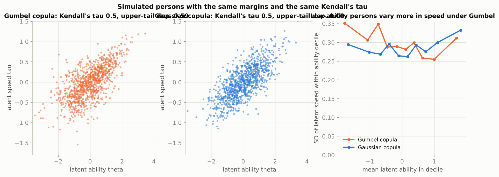
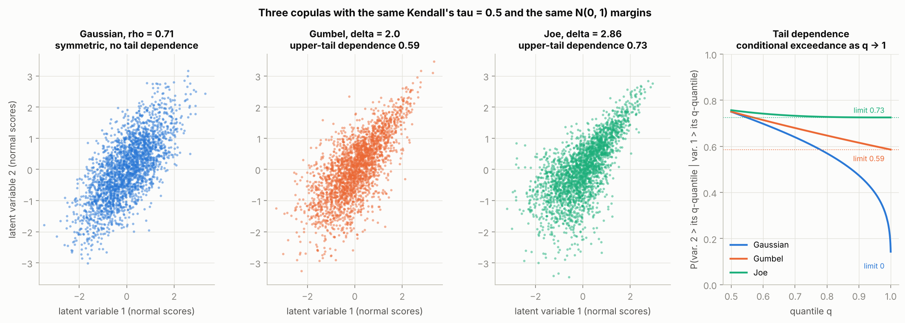

# Copula-based latent variable models in NumPyro

Notes from a UW seminar by Sunbeom Kwon (College of Education postdoc),
*Copula-Based Latent Variable Modeling for Asymmetric Dependence*, 2026-10-14.
The talk covers two studies:

1. **Kwon & Zhang, "A copula-based joint model for speed and accuracy"**
   (Psychometrika, in press; presented at IMPS 2025 and NCME 2026). Van der
   Linden's hierarchical model for item responses and response times, with the
   bivariate-normal link between latent ability and latent speed replaced by a
   **Gumbel copula** (upper-tail dependence).
2. **Kwon & Zhang, "Predicting binary risk outcomes via copula-based SEM"**
   (in preparation). The same idea in an SEM with a rare binary outcome such as
   suicide attempt, where Gaussian dependence underestimates joint risk.

Neither paper is public yet, so this directory simulates data from each setting
as I understand it from the abstracts, fits the copula models and the usual
Gaussian-dependence versions with NumPyro (NUTS), and compares them.

RESULTS_TLDR

## Why a copula

A multivariate normal says the dependence between two latent variables is
linear, symmetric, and tail-independent: knowing that someone is extreme on one
trait tells you nothing extra about whether they are extreme on the other,
beyond the correlation. Sklar's theorem splits any joint distribution into
margins plus a *copula* that carries the dependence, so you can keep normal
margins for the latent traits and swap in a copula with the dependence shape you
want. The Gumbel copula has upper-tail dependence
`lambda_U = 2 - 2^(1/delta)`: high values travel together, low values do not.



Both panels have the same margins and the same Kendall's tau. In the Gumbel
panel (left) the fast-and-able corner is tight while speed among low-ability
persons is spread out, which is the empirical pattern Kwon & Zhang cite as
motivation (Domingue et al., 2022: more response-time variability among lower
ability test-takers).

## Gumbel, Joe, and what a vine would add



The Gaussian copula is a bivariate normal pushed through its own margins. It is
radially symmetric and tail independent: in the right panel, the probability
that variable 2 is above its q-quantile given that variable 1 is falls to zero
as q goes to 1, for every correlation below 1.

Gumbel and Joe are both Archimedean copulas, `C(u, v) = psi(psi^-1(u) +
psi^-1(v))` for a generator `psi`, with one parameter `delta >= 1` (1 is
independence). The mechanical picture is a shared frailty: one latent
multiplier per person, and each coordinate is `psi(E / V)` with an independent
exponential `E`. The shape of `psi` decides where the dependence concentrates.
Both families have upper-tail dependence `2 - 2^(1/delta)` and none in the
lower tail. They differ once overall dependence is held fixed:

| at Kendall's tau = 0.5 | Gaussian | Gumbel | Joe |
|---|---|---|---|
| parameter | rho = 0.71 | delta = 2.0 | delta = 2.86 |
| upper-tail dependence (limit) | 0 | 0.59 | 0.73 |
| P(var 2 > 99th pct given var 1 > 99th pct) | 0.27 | 0.59 | 0.73 |
| P(var 2 < 1st pct given var 1 < 1st pct) | 0.27 | 0.15 | 0.03 |
| Kendall's tau from the parameter | (2/pi) arcsin(rho) | 1 - 1/delta | series only |
| special role | multivariate normal with normal margins | extreme-value (max-stable) copula | building block of the two-tail BB7 family |

Joe puts almost all of its dependence in the top corner and leaves the rest of
the distribution close to independent; Gumbel spreads it more evenly with a
milder tilt. Gumbel is also the extreme-value copula: component-wise maxima of
many independent pairs have a Gumbel-type copula in the limit. Both can be
rotated: 180 degrees (the survival copula) moves the tail to the bottom, 90 or
270 degrees give negative dependence, which matters because the ability-speed
correlation is negative on some tests. Two-parameter cousins cover both tails
at once (BB1 is Clayton-Gumbel, BB7 is Joe-Clayton).

A vine copula is a construction rather than a family, and it answers a
different question: dimension. One Gumbel or Joe copula on three or more
variables is exchangeable with a single parameter, so every pair gets the same
strength and the same tail. A vine (pair-copula construction) writes a
d-dimensional density as a product of d(d-1)/2 bivariate copulas arranged in
trees. The first tree joins variables directly, later trees join conditional
distributions, and the data for those come from the conditional CDFs, the
h-functions, which are the same functions `copulas.log_hfunc_z` computes for
the binary-outcome model. Each pair can be any family with its own parameter,
under the usual simplifying assumption that the conditional pair copulas do not
depend on the conditioning values. With every pair Gaussian the vine collapses
to a multivariate normal. With two latent variables a vine is one bivariate
copula, so neither of the speaker's models needs one; it becomes relevant for an
SEM with three or more latent variables, such as depression, hopelessness and an
outcome propensity, each pair with its own tail shape.

## The trick in six lines of NumPyro

If `theta` and `tau_std` have standard-normal margins and copula density `c`,
their joint density is `phi(theta) phi(tau_std) c(Phi(theta), Phi(tau_std))`.
So two independent `Normal(0, 1)` draws supply the margins and a
`numpyro.factor` adds the log copula density:

```python
with numpyro.plate("persons", n_persons):
    theta = numpyro.sample("theta", dist.Normal(0.0, 1.0))
    tau_std = numpyro.sample("tau_std", dist.Normal(0.0, 1.0))
ktau = numpyro.sample("ktau", dist.Beta(2.0, 2.0))              # Kendall's tau
numpyro.factor("copula", jnp.sum(cp.logpdf_z(theta, tau_std, "gumbel", ktau)))
```

See `speed_accuracy.py:119`. The copula functions live in `copulas.py`
(Gaussian, Gumbel, Joe, Clayton; rotations by 90/180/270 degrees for negative
dependence or the opposite tail; all parameterised by Kendall's tau so the
families are comparable, with Joe's tau-to-delta map tabulated from its
series). Two numerical details matter in practice:

- Everything works from `norm.logcdf(z)` rather than `Phi(z)`, and the Gumbel
  and Clayton formulas are rearranged so the small tail terms are never
  absorbed into large ones (`copulas.py:111`). The first draft computed
  `P(Y=1 | eta)` as exactly zero at `eta = -7`, which NUTS does not forgive.
- 64-bit JAX (`numpyro.enable_x64()`) is required; float32 loses the tails.

For a binary outcome (Study 2) there is a second ingredient. If the outcome is
`Y = 1{y* > c}` with `y*` latent and `(eta, y*)` joined by a copula, then

```
P(Y = 1 | eta) = 1 - h(Phi(c) | Phi(eta)),   h(v | u) = dC(u, v) / du
```

The conditional CDF `h` is closed-form for all three families
(`copulas.log_hfunc_z`), so `y*` never has to be sampled; the model is a
Bernoulli likelihood with a copula-shaped link (`risk_sem.py:99`). Under a
Gaussian copula this reduces to the familiar probit regression on `eta`.

`test_copulas.py` (46 tests, `uv run pytest`) checks that each density
integrates to one, that `h` is the integral of the density and the density the
mixed derivative of the CDF, that the samplers reproduce Kendall's tau and the
right tail, and that gradients stay finite far into the tails.

## Study 1: speed and accuracy

**Data.** 1,000 persons by 20 items. Responses follow a two-parameter logistic
model, log response times a log-normal model with item time intensity and time
precision, as in van der Linden (2007):

```
Y_ij    ~ Bernoulli(logit^-1(a_j (theta_i - b_j)))
log T_ij ~ Normal(beta_j - tau_i, 1 / alpha_j)
theta_i ~ N(0, 1),  tau_i ~ N(0, 0.4^2),  (Phi(theta_i), Phi(tau_i / 0.4)) ~ Gumbel(delta = 2)
```

Kendall's tau between ability and speed is 0.5 and the upper-tail dependence
coefficient is 0.59.

**Models.** Four NumPyro models on the same data set, NUTS with 2 chains of
1,000 warmup and 1,000 draws each:

| model | dependence between ability and speed |
|---|---|
| `2pl_only` | response times ignored |
| `gaussian` | bivariate normal (van der Linden's hierarchical model) |
| `gumbel` | Gumbel copula, the speaker's model |
| `joe` | Joe copula, the other upper-tail family the speaker likes |
| `clayton` | Clayton copula, an asymmetric copula with the *wrong* (lower) tail |

**What is compared.** The three claims in the abstract, in order: ability
recovery (RMSE of the posterior-mean ability against the truth, overall and by
tercile of true ability), model fit (per-person WAIC), and whether the fitted
model reproduces the tail behaviour of the data, as a posterior predictive
check. The check uses an observable *tail concentration*: among persons in the
top 10% (or 20%) of observed score, the share who are also in the top 10% (or
20%) of observed speed (fastest mean log response time), and the same at the
bottom. Upper-tail dependence makes the top share exceed the bottom share; a
Gaussian copula makes them equal. Each model is refit to 10 further simulated
data sets so the comparisons carry standard errors.

RESULTS_STUDY1

## Study 2: a rare binary risk outcome

This paper is not public, so this is one reading of the abstract. One latent
risk factor `eta` (think depressive symptoms) is measured by six continuous
indicators; the outcome is rare (3% prevalence) and is linked to the risk
factor through a copula between `eta` and the latent outcome propensity `y*`:

```
x_ik ~ N(nu_k + lambda_k eta_i, sigma_k^2),  k = 1..6
(Phi(eta_i), Phi(y*_i)) ~ Gumbel(delta = 2),  Y_i = 1{y*_i > Phi^-1(0.97)}
```

Under a Gaussian copula with latent correlation `rho` this is the standard
probit SEM, `P(Y=1 | eta) = Phi((rho eta - c) / sqrt(1 - rho^2))`. Under the
Gumbel copula `P(Y=1 | eta)` rises much more steeply in the upper tail: at the
99th percentile of the risk factor the true outcome probability is 0.69, while
a Gaussian copula with the same Kendall's tau gives 0.37.

**Models.** Gaussian, Gumbel, Joe and Clayton copula SEMs, each fit to 3,000
training persons, then used to predict 20,000 held-out persons from their
indicators alone (`eta | x` is Gaussian under the linear measurement model, so
the prediction integrates `P(Y=1 | eta)` over it by Gauss-Hermite quadrature,
averaged over posterior draws).

RESULTS_STUDY2

## Files

| file | what |
|---|---|
| `copulas.py` | Gaussian / Gumbel / Joe / Clayton copulas in JAX: log density, conditional CDF, samplers, tail coefficients, rotations |
| `test_copulas.py` | 46 tests (`uv run pytest`) |
| `speed_accuracy.py` | Study 1: simulation, five NumPyro models, metrics, posterior predictive check |
| `risk_sem.py` | Study 2: simulation, four copula SEMs, out-of-sample prediction |
| `copula_families_figure.py` | the Gaussian / Gumbel / Joe explainer figure |
| `aggregate_reps.py` | tables from the 10 replication seeds |
| `make_figures.py` | the other figures, from `results/` |
| `run_all.sh` | reproduces everything, sequentially (about 2 hours) |
| `results/study*/summary.json`, `results/replications.json` | every number quoted here |

```bash
uv sync
uv run pytest
./run_all.sh          # or: uv run python speed_accuracy.py; uv run python risk_sem.py; uv run python make_figures.py
```

One model fit (NUTS, 2 chains of 1,000 + 1,000) takes about a minute on 4 CPU
cores for either study, so a full study is about 5 minutes and `run_all.sh`
with its 10 replication seeds about 2 hours. Do not run two JAX processes at
once: the CPU oversubscription slows both by an order of magnitude.

## Caveats, and questions for the speaker

- **Both papers are unpublished.** Study 1 follows the IMPS abstract closely
  (2PL, log-normal, Gumbel between ability and speed). Study 2 is my
  reconstruction of a one-paragraph abstract: one latent factor, continuous
  indicators, and a copula between the factor and the outcome propensity.
  Another reading puts the copula among several latent predictors with an
  ordinary logistic outcome; the mechanics in `copulas.py` cover that too.
- **Kwon & Zhang use stochastic-approximation EM; this uses NUTS.** At this
  scale NUTS is fast (seconds per model) and gives the copula parameter a
  posterior interval for free. The latent variables enter as 1,000 to 3,000
  extra parameters, which NUTS handles without trouble.
- **The pattern that motivates Study 1 is subtle at this dependence level.**
  My first posterior predictive statistic, the spread of mean log response
  time within score quintiles, is flat in every copula world I simulated at
  Kendall's tau 0.5, Gaussian included, within replication noise. The tail
  concentration statistic separates the families; dispersion does not. So the
  extra response-time variability among low scorers that Domingue et al.
  (2022) report may need more than a copula on the person distribution, for
  example ability-dependent residual variance or rapid guessing. Worth asking
  which statistic they use and whether the copula model reproduces it.
- **A misspecified copula distorts the dependence parameter, not only the
  tail.** The Gaussian fit in Study 2 returns Kendall's tau of 0.64 for data
  generated with 0.5: it inflates the overall dependence to buy some of the
  tail it cannot represent.
- **AUC cannot show the gain.** All copulas rank persons by the same
  posterior mean of the latent factor, so AUC is identical to three decimals.
  The improvement is in calibration and log-loss at the top of the risk
  distribution, which is what a rare-outcome screen needs. How the paper
  defines "improved prediction" matters.
- **Gumbel versus Joe is hard to tell apart from a binary outcome.** Both
  reproduce the top 1% rate; log-loss differs in the fourth decimal. The
  families differ in the lower tail, where a rare outcome carries almost no
  information. Model choice between them would rest on prior grounds or on
  the response-time setting, where the whole distribution is observed.
- **Simplifications.** Continuous indicators (questionnaire items would be
  ordinal), 3% prevalence with about 100 training events, positive dependence
  only (real ability-speed correlations are sometimes negative, which the
  rotations in `copulas.py` handle but the scripts do not exercise), and no
  item-level or vine extensions.

## Sources

- Seminar announcement (abstract quoted in the task); CV of Sunbeom Kwon,
  https://sunbeomk.github.io/assets/pdf/Kwon_Sunbeom_CV.pdf (lists both papers)
- IMPS 2025 abstract, "A copula-based joint model for item responses and
  response times" (Kwon & Zhang), p. 40 of
  https://www.psychometricsociety.org/sites/main/files/file-attachments/imps2025-abstracts.pdf
- Illinois Psychology news item on the IMPS 2025 travel award:
  https://psychology.illinois.edu/news/2025-05-27/sunbeom-kwon-trung-le-are-heading-international-meeting-psychometric-society
- van der Linden, W. J. (2007). A hierarchical framework for modeling speed
  and accuracy on test items. *Psychometrika*, 72, 287-308.
  https://link.springer.com/article/10.1007/s11336-006-1478-z
- Hofert, M. (2011). Efficiently sampling nested Archimedean copulas.
  *Computational Statistics & Data Analysis* (the Marshall-Olkin / positive
  stable sampler used in `copulas.sample`).
- Nikoloulopoulos & Joe, factor copula models for item response data,
  *Psychometrika* 2015, for copulas in IRT more broadly:
  https://www.cambridge.org/core/journals/psychometrika/article/abs/factor-copula-models-for-item-response-data/8ECB92F29C0DC97EED08CBE85376869C
