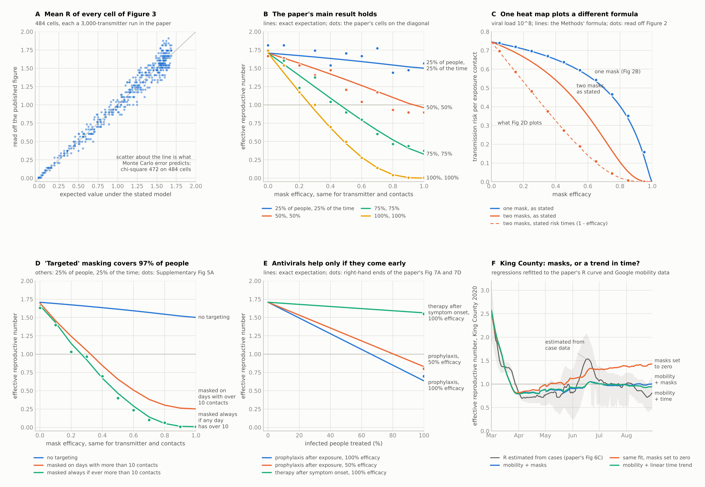

# Masks, exposure viral load and SARS-CoV-2 transmission: a camdl replication

Replicates Goyal, Reeves, Thakkar, Famulare, Cardozo-Ojeda, Mayer & Schiffer (2021),
"Slight reduction in SARS-CoV-2 exposure viral load due to masking results in a
significant reduction in transmission with widespread implementation",
*Scientific Reports* 11:11838,
[doi:10.1038/s41598-021-91338-5](https://doi.org/10.1038/s41598-021-91338-5),
using [camdl](https://github.com/vsbuffalo/camdl) for the within-host model.



## Headline

The paper's conclusions about masks and antivirals replicate from the model it
states, and they replicate closely. I read all 484 cells off its Figure 3, and they
scatter around my expected values by as much as its 3,000-transmitter Monte Carlo
runs should and no more (chi-square 472 on 484 cells). Three things in the paper do
not follow from that model, however, and its title deserves a number.

1. Two published heat maps of transmission risk under dual masking (Figure 2D and
   Supplementary Figure 2) plot formulas other than the one in the Methods. The
   caption's statement that a mask does more on the exposed contact than on the
   transmitter comes from the second of these, since the stated model is symmetric.
2. The "targeted" scenario, in which people with more than 10 exposure contacts per
   day always wear masks, is reproduced only by a reading that masks 97% of
   everyone, which is why its four panels look alike.
3. The King County regression reproduces (I get a 30% reduction in R_e from masks,
   the paper 27%), but replacing mask wearing with a straight line in time fits the
   same data better.

On the title: in this model transmission is close to proportional to exposure viral
load, so a mask that halves exposure viral load prevents 45% of the transmissions
in the pairs that wear it. The reduction is worth having, and it is about as large
as the filtering, a little smaller for a weak mask and a little larger for a strong
one.

| Claim | Paper | Here | Verdict |
|---|---|---|---|
| Mean R_0 without masks | ~1.8 | 1.71 (the paper's runs carry a standard error of 0.11) | **Replicates** |
| Infected people who transmit to anyone, no masks | 26.7% (Fig 7B), "30%" in the text | 24.6% | **Replicates**, the 30% does not |
| Infected people who transmit to 5 or more | ~10% | 9.4% | **Replicates** |
| Transmission risk with one mask, any viral load (Fig 2B, 2C) | heat maps | same formula, to 0.01 | **Replicates** |
| Both masked at 0.9: risk under 5% below 10^8.5 copies, ~20% at 10^9 | text | 8% at 10^8.5 (under 5% below 10^8.3), 25% at 10^9 | **Replicates** approximately |
| Transmission risk with both masked (Fig 2D, Supp Fig 2) | heat maps | a different formula from the Methods (finding 3) | **Does not replicate** |
| A mask on the exposed contact prevents more than one on the transmitter (Supp Fig 2 caption) | yes | no: the stated model is symmetric | **Does not replicate** |
| 50% of people masked 50% of the time, efficacy 0.9: R_e ~1.0 | ~1.0 | 1.02 | **Replicates** |
| 75%, 75%, efficacy 0.5: R_e ~1.0 | ~1.0 | 0.94 | **Replicates** |
| 100%, 100%: efficacy 0.3 gives R_e ~1.0, efficacy 0.5 under 0.6 | ~1.0, <0.6 | 0.93, 0.47 | **Replicates** |
| 25%, 25%: differences between cells are Monte Carlo noise | yes | yes: R_e 1.50 to 1.71 across the panel, standard error 0.11 | **Replicates** |
| Recent US R_e of 0.8 to 1.2 at 75%, 75% implies efficacy 0.3 to 0.6 | 0.3 to 0.6 | R_e 1.25 at 0.3, 0.79 at 0.6 | **Replicates** |
| All 484 cells of Figure 3 | heat maps | chi-square 472 on 484 cells | **Replicates** |
| R_e by masking status of the pair (Fig 4, 64 bar segments) | bars | chi-square 40 on 64 segments | **Replicates** |
| At 75%, 75% and efficacy 0.3 to 0.6, under half of transmissions are between unmasked pairs | <50% | 26% and 41% | **Replicates** |
| Dual masking at 0.6 and 0.9 lowers exposure viral load at transmission by ~1 and ~2 logs | ~1, ~2 | 0.55 and 1.54 (the paper's own Fig 5B shows 0.60 and 1.77) | **Figure replicates**, the text rounds up |
| 50%, 50%, efficacy 0.5: share who transmit falls from 30% to 20%, and to ~15% at 75%, 75% | 30 to 20, then 15 | 24.5 to 20.5, then 15.9 | **Replicates** except the 30% |
| Clusters of more than 5 carry most of R_e at every level of masking | yes | 73% to 79% | **Replicates** |
| Among people who transmit, the share infecting 5 or more falls as masking rises | yes | 38% without masks, 33% at 75%, 75% and efficacy 0.5, 28% at 100%, 100% | **Replicates** |
| With high-contact people always masked, efficacy ~0.5 elsewhere keeps R_e under 1 | yes | yes: 0.46 under the reading that reproduces the paper's figure, 0.66 as I read the text (finding 4) | **Replicates**, with a caveat |
| King County, 30 August 2020: R_e 1.48 without masks, 1.08 with, a 27% reduction | 1.48, 1.08, 27% | 1.43, 1.00, 30% (95% interval 17 to 41) | **Replicates** |
| That reduction is the effect of masks | yes | a linear time trend fits better (finding 6) | **Not identified** |
| Early symptomatic therapy does not lower R_e | flat at ~1.7 | 1.56 with everyone treated, down 8% from 1.71 (the paper's line ends near 1.55) | **Replicates** |
| Prophylaxis after exposure: R_e under 1 needs 50% efficacy and ~75% uptake | ~75% | 80% uptake at 50% efficacy, 66% at 100% | **Replicates** |
| Efficacy above 50% adds little | yes | R_e with everyone treated: 0.83 at 50%, 0.67 at 70%, 0.63 at 100% | **Replicates**, though "minimal to no" is a little strong |
| Prophylaxis must start within 2 to 3 days of exposure | yes | R_e with everyone treated: 0.05 on day 2, 0.46 on day 3, 1.01 on day 4 | **Replicates** |

## What was done

The model has two layers. The first is a within-host model of viral load: six
ordinary differential equations for target cells, infected cells, virus and a
two-stage effector response, fitted to 25 untreated people in the authors' earlier
work. The second turns a person's viral load on each day into secondary infections.
A transmitter meets a gamma-distributed number of "exposure contacts" each day
(mean 4, with most days near zero and an occasional day in the dozens), and each
contact is infected with probability `P(V)^2`, where `P(V) = V^0.8 / (10^5.6 + V^0.8)`
is a dose-response curve used once for contagiousness and once for infectiousness.
A mask of efficacy `eps` multiplies the viral load that reaches the contact by
`1 - eps`, once for the transmitter's mask and once more for the contact's.

- `within_host.camdl` is the first layer: real-valued compartments with their
  derivatives written out, and antiviral treatment as a camdl intervention that
  cuts viral production at a time set per person. `viral_load.py` runs it for the
  10,000 parameter sets the authors published with their companion eLife paper,
  as one `--sweep-file` design on the ODE backend.
- `transmission.py` is the second layer. It follows the Supplementary methods step
  by step and, where they are silent (the daily time step, the 20-day cutoff, the
  rounding of each person's count), the authors'
  [R code for the eLife paper](https://github.com/ashish2goyal/SARS_CoV_2_Super_Spreader_Event).
  The code for the masking paper itself is not public. Without masks the port
  reproduces the summary statistics of the eLife paper (`results/baseline.tsv`).
- The paper estimates each R_e by Monte Carlo over 3,000 transmitters, whose
  individual counts have a standard deviation of 6 around a mean under 2. The mean
  being estimated has a closed form given the viral loads (a day contributes
  `4 P(V)^2`, weighted by how often each pair is masked), so I report that exact
  expectation over all 10,000 parameter sets, together with the standard error a
  3,000-transmitter run carries around it.
- `digitize/` reads the paper's numbers back off its figures: heat-map cells
  against their own colour bars, bar heights, box plots, and the two curves of
  Figure 6. The supplementary figures come from a Word file of vector drawings,
  rendered through LibreOffice.
- `compare_integrators.py` runs the same equations through scipy's LSODA, the
  method the authors use in R. camdl agrees to better than one part in ten
  million, with and without treatment.

## Findings

### 1. The stated model reproduces Figure 3, noise included

Each cell of Figure 3 is the mean of 3,000 heavily skewed counts, so the published
heat maps are noisy, and a replication should match them only up to that noise. For
each cell I computed the expected value, the standard error of a 3,000-transmitter
run, and the difference from the value read off the figure in units of that error.
The differences have mean 0.1 and standard deviation 1.0 across the 484 cells, which
is what a correct replication looks like (panel A of the figure). The same comparison
for the 64 bar segments of Figure 4 gives a chi-square of 40.

The panel for 25% of people masked 25% of the time shows what the noise does. Its
expected values run only from 1.50 to 1.71, because fewer than one pair in eight
includes a mask at all, while the published cells run from 1.34 to 1.91. The paper
says as much.

### 2. Transmission is close to proportional to exposure viral load

The dose-response curve is steep for one contact, and the paper's opening figures
make much of that. Averaged over the viral loads at which transmission happens,
however, the steepness washes out:

| Exposure viral load multiplied by | 0.9 | 0.7 | 0.5 | 0.3 | 0.1 | 0.01 |
|---|---|---|---|---|---|---|
| Expected transmissions multiplied by | 0.92 | 0.75 | 0.55 | 0.33 | 0.094 | 0.004 |

This has a useful consequence. If each party to a contact is masked a fraction `c`
of the time, `R_e = R_0 (1 - c eps_T)(1 - c eps_E)` reproduces the expected value of
every cell of Figure 3 to within 0.09, and of half of them to within 2%. The paper's
result is then a matter of arithmetic: with 75% of people masked 75% of the time
(`c = 0.56`) and efficacy 0.5 on both sides, the formula gives a 48% cut in R_e, and
the full calculation 45%.

### 3. Figure 2D and Supplementary Figure 2 plot something else

The Methods give one formula for the risk to one exposure contact,
`P(V (1 - eps_T)(1 - eps_E))^2`. I read each pairwise figure back to numbers and
fitted a family that allows an extra multiplier on the risk and free exponents
inside the dose-response curve (`digitize/decode_pairwise_figures.py`).

| Figure | What it plots | Misfit of the stated formula (RMS) |
|---|---|---|
| 2B, 2C: one mask | the stated formula | 0.01 |
| Supp 1A, 1C: curves, one mask and two | the stated formula | under 0.01 |
| 2D: two masks, same efficacy | the stated risk times `(1 - eps)` | 0.22 |
| Supp 2: two masks, efficacies varied | `(1 - eps_E) P(V (1 - eps_T))^2` | 0.065 |

In Figure 2D the fitted exponents are 0.98 on the multiplier and 1.98 inside the
curve, where the formula has 0 and 2. At a viral load of 10^10 and efficacy 0.5 the
panel shows a risk of 0.49, and the formula gives 0.98. In Supplementary Figure 2
the contact's mask multiplies the risk and does not touch the viral load at all, so
the panel is lopsided, and its caption reads the lopsidedness as a result.

I cannot say how these two panels were made. The numbers quoted in the text for
dual masking agree with the stated formula, and so does every population-level
figure: the heat maps of Figure 3 prefer the stated model to the Supplementary
Figure 2 version by 36 units of chi-square. The policy conclusions do not depend
on the two panels. A reader who takes the dual-masking heat map at face value,
however, will think two masks do far more for one contact than the model says.

### 4. "People with more than 10 contacts a day" is almost everyone

The model has no high-contact people. Everyone draws a new number of contacts each
day from the same distribution, in which 10% of days have more than 10 contacts and
those days carry 82% of all contacts. In a model where everyone rolls the dice
again each morning, nearly everyone is a potential super-spreader by the end of the
month: 97% of transmitters have at least one such day in the 31 simulated.

The four panels of Supplementary Figure 5 are reproduced when anyone who ever has
such a day is masked on every day, along with their contacts (chi-square 370 on
484 cells, against 9,191 when masks go on only on the busy days). That is universal
masking under another name, and it is why the panels do not change with the uptake
assumed for everyone else.

Read as person-days, the scenario is still worth something. Masking both parties on
the 10% of days with more than 10 contacts, at efficacy 0.5, takes R_e from 1.61 to
0.66 when the rest of the population is at 25% and 25%, which is most of the way to
the 0.47 of universal masking. The paper's conclusion survives. The mechanism it
suggests, a subgroup one could find and mask, is not in the model.

### 5. Antivirals

Treatment multiplies viral production by one minus its efficacy from the moment it
starts. Uptake is an independent coin flip for each infected person, so every curve
in Figure 7A to 7F is a straight line from no uptake to full uptake, and the wiggles
in the published lines are Monte Carlo noise. Only the endpoints need computing.

| Everyone treated | R_e | Paper (read by eye) | Share transmitting | Uptake needed for R_e = 1 |
|---|---|---|---|---|
| Untreated | 1.71 | 1.8 | 24.7% | |
| Therapy 0.5 to 5 days after symptom onset, 100% efficacy | 1.56 | 1.55 | 21.5% | cannot reach 1 |
| Prophylaxis 0.5 to 5 days after exposure, 30% efficacy | 1.14 | 1.15 | 18.0% | cannot reach 1 |
| Prophylaxis 0.5 to 5 days after exposure, 50% efficacy | 0.83 | 0.80 | 12.7% | 80% |
| Prophylaxis 0.5 to 5 days after exposure, 70% efficacy | 0.67 | 0.70 | 9.3% | 69% |
| Prophylaxis 0.5 to 5 days after exposure, 100% efficacy | 0.63 | 0.70 | 8.2% | 66% |

The paper's two conclusions hold. Therapy that waits for symptoms comes too late:
72% of expected transmission happens within 3.5 days of exposure and 93% within 5.5,
while the median incubation period is 4.7 days, so a perfect drug given to everyone
0.5 to 5 days after symptom onset removes 8% of transmission. Prophylaxis after
exposure can bring R_e under 1, and at 50% efficacy it needs 80% uptake (the paper
says about 75%). The statement that efficacy beyond 50% adds "minimal to no" benefit
is a little strong, since a 50% drug delivers 82% of what a perfect one does and a
70% drug 96%. The floor of 0.63 is set by the clock, not the drug.

| Fully effective prophylaxis for everyone, started on day | 1 | 2 | 3 | 4 | 5 | 6 |
|---|---|---|---|---|---|---|
| Paper, Figure 7G (read by eye) | 0.00 | 0.03 | 0.50 | 1.10 | 1.45 | 1.40 |
| Start uniform over that day | 0.00 | 0.05 | 0.46 | 1.01 | 1.36 | 1.53 |
| Start at the plotted time (0.5, 1.5, ... days) | 0.00 | 0.09 | 0.74 | 1.22 | 1.47 | 1.58 |

Panel G plots six points at 0.5 to 5.5 days and does not say how the start time
within a day was set. A start spread uniformly over the day matches the published
line to within its Monte Carlo error. A start at exactly the plotted time gives 0.74
on day 3 where the paper shows 0.50, because viral load is read at those same times
and a drug started at the instant of a reading cannot change it. Either way the
message is the paper's: started within two days of exposure, a perfect drug for
everyone nearly stops transmission, and started on day 4 it no longer brings R_e
under 1.

### 6. The King County regression replicates, and so does a placebo

The paper regresses the log of R_e in King County on mobility and mask wearing and
reads the effect of masks off the fit. The case data are held under a data use
agreement, so I traced the R_e curve and the mask-survey curve from Figure 6 and
paired them with Google's public mobility data (`run_king_county.py`).

| Regression of log R_e, 1 March to 30 August 2020 | R^2 | Mask coefficient (SE) | R_e on 30 August, fitted | Without masks |
|---|---|---|---|---|
| Paper | | | 1.08 | 1.48 |
| Mobility + masks | 0.64 | 0.16 (0.04) | 1.00 | 1.43 |
| Mobility + linear time trend, no masks | 0.67 | | | |
| Mobility + masks + time trend | 0.69 | -0.34 (0.20) | | |
| Mobility + masks, survey period only (from 7 May) | 0.37 | 0.71 (0.20) | 0.96 | 4.7 |

My refit (second row) recovers the paper's result to within the accuracy of a curve
traced from a blurred image. The remaining rows are why I would not lean on it. Mask
wearing rose smoothly from an assumed 1% in March to 89% in August, and anything
else that drifted over those months is indistinguishable from it: a straight line in
time fits better, and with both in the model the mask coefficient changes sign. More
than half of the rise in mask wearing predates the survey and is the authors'
interpolation. Restricted to the months with survey data, the same regression says
that without masks R_e would have been 4.7. The daily values are also far from
independent (Durbin-Watson 0.05), which the standard errors above allow for; the
paper does not say whether its interval of 1.38 to 1.58 does.

### 7. Small things

- The text gives the share of infected people who transmit as 30% without masks.
  The paper's Figure 7B shows 26.7%, the companion paper about 25%, and I get 24.6%.
- The authors' parameter file does not quite match the table in the Supplementary
  methods: the standard deviation of log10 beta is 0.18 where the table says 0.2,
  and that of k is 0.002 where the table says 0.02. I used the file.
- Each person's count is rounded to an integer before averaging, which lowers mean
  R by 0.015. A count is real-valued because a day contributes `P` times the
  number of contacts when a single coin with probability `P` comes up heads, and
  nothing otherwise.
- The paper reads viral load once a day, on the assumption that it changes little
  within a day. It can change a hundredfold, but the mean does not care:
  for the first 2,000 parameter sets R_0 is between 1.71 and 1.73 whatever time
  of day is used, and 1.72 as a continuous integral (`check_daily_sampling.py`).
- Figure 5 depends on what counts as a "successful transmission event", which the
  paper does not define. I used the days on which a transmitter's rounded running
  total rises. My medians sit a little below the published ones (0.07 log on
  average, 0.18 at most), and the published boxes rest on one or two hundred
  events each.

## Where camdl fits, and where it does not

The within-host model is a natural fit: six real compartments, an `ode { }` block,
and a `--sweep-file` of 10,000 parameter sets that runs in about 80 seconds. The
compiler caught one slip before anything ran (I had named viral production `pi`,
which is reserved). Treatment was more instructive. Written as
`if t > t_treat then ... else ...` inside the rate, it made the adaptive
integrator reject steps at the jump and stop with an error that names the time
(and blames stiffness, which was not the cause). Written as an intervention,
`start_treatment : { Rx = 1.0  at = [t_treat] }`, with `t_treat` a swept parameter,
the integrator stops at the jump and restarts, and the result matches scipy to
better than one part in ten million. An intervention that is declared but not
enabled does nothing and says nothing, which cost me one puzzling run.

The transmission layer is not a compartmental model, and I left it in Python. It
is a per-person tally with the paper's own idiosyncrasies (one coin per day,
real-valued counts, rounding), and a faithful replication has to reproduce those
rather than a cleaner process with the same mean. camdl's gamma white noise on a
Poisson inflow would express that cleaner process in a few lines, and since the
mean does not depend on the daily grid it would give the same R_e. It would not
give the same distribution of individual counts, and I have not built it.

## What remains open

The masking paper's simulation code would settle how Figure 2D and Supplementary
Figure 2 were drawn and how "successful transmission events" were counted. The
R_e series in the regression is a tracing, good to about 0.03, and the original
would allow a proper treatment of its uncertainty. I did not read Supplementary
Figure 3 cell by cell, only the numbers the text quotes from it. The dose-response
parameters were calibrated in the companion paper to early-pandemic data and are
taken as given here, as is the assumption that a mask acts only by scaling the
dose, which is the paper's premise and not something a replication can test.

## Files

| File | What it is |
|---|---|
| `within_host.camdl` | the within-host model, with treatment as an intervention |
| `viral_load.py` | runs it through camdl for the published parameter sets |
| `within_host_scipy.py`, `compare_integrators.py` | the same equations in scipy, and the comparison |
| `transmission.py` | contacts, dose response, masks: the Monte Carlo and its exact expectation |
| `test_transmission.py` | checks on that layer (`uv run pytest`) |
| `run_masks.py` | Figures 2 to 5 and Supplementary Figures 3 to 5 |
| `run_antivirals.py` | Figure 7 |
| `run_king_county.py` | Figure 6 |
| `check_daily_sampling.py` | R_0 against the time of day viral load is read |
| `plot_replication.py` | the figure above |
| `digitize/` | scripts that read values off the published figures, and `get_figures.sh` to fetch them |
| `data/SimulatedParameters.txt` | the authors' 10,000 within-host parameter sets, unmodified |
| `data/google_mobility_king_county_2020.tsv` | Google COVID-19 Community Mobility Reports, King County rows |
| `data/paper_*_digitized.tsv` | values read off the paper's figures |
| `results/*.tsv` | every number quoted above |

## Running it

```bash
uv sync
uv run python viral_load.py
uv run python compare_integrators.py
uv run python run_masks.py
uv run python run_antivirals.py
uv run python run_king_county.py
uv run python check_daily_sampling.py
uv run python plot_replication.py
```

camdl 0.1.0+452708f (November 2026), built from source with its `install.sh`.
The antiviral runs take about half an hour, and everything else is minutes.
