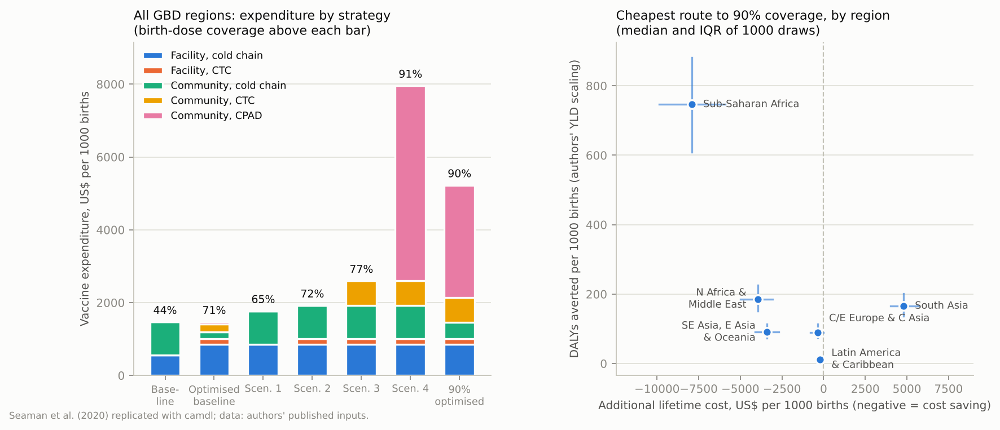

# Hepatitis B birth dose, CTC and CPAD devices — a camdl replication

Replicates Seaman, Morgan, Howell, Xiao, Spearman, Sonderup, Lesi, Andersson,
Hellard & Scott (2020), "Use of controlled temperature chain and compact prefilled
auto-disable devices to reach 2030 hepatitis B birth dose vaccination targets in
LMICs: a modelling and cost-optimisation study", *Lancet Global Health* 8:e931–41,
[doi:10.1016/S2214-109X(20)30231-X](https://doi.org/10.1016/S2214-109X(20)30231-X),
using [camdl](https://github.com/vsbuffalo/camdl).



## Headline

Every policy conclusion of the paper replicates. The absolute DALY numbers do not:
the authors' code counts years lived with disability about 30 times over, and the
paper's "389 DALYs per 1000 births" is almost entirely that overcount.

| Claim (All GBD regions unless stated) | Paper | camdl | Verdict |
|---|---|---|---|
| Baseline birth-dose coverage | 44% | 44.2% | **Replicates** |
| Maximum coverage under current protocols (scenario 1) | 65% (IQR 64–66) | 65.0% | **Replicates** |
| Coverage with CTC and CPAD everywhere (scenario 4) | 91% | 91.3% | **Replicates** |
| 90% reachable with CTC alone only in SE Asia, E Asia & Oceania | yes | yes (90.3%; next best 89.4%) | **Replicates** |
| Cheapest route to 90% in all six regions, per year | $687.5 million | $687.5 million | **Replicates exactly** |
| … of which on CTC and CPAD | $516.5 million (75%) | $516.5 million (75%) | **Replicates exactly** |
| Increase over current expenditure | $494.0 million | $494.0 million | **Replicates exactly** |
| 90% optimum cost saving in 5 of 6 regions; South Asia ICER up to $37.49 | yes | yes; South Asia $36 per DALY (median $28.80, IQR 20.43–41.01) | **Replicates** |
| Scenario 4 cost saving in 4 regions; exceptions Central/Eastern Europe & Central Asia (ICER ≤ $4.79) and South Asia (≤ $94.58) | yes | yes; $2.5 and $91 per DALY | **Replicates** |
| 90% coverage cost saving in 40 of 46 LMICs | 40 | 38 (Peru and Colombia cost an extra $0.04–0.05 per birth; see finding 2) | **Replicates in substance** |
| CPAD not needed in Suriname and Costa Rica; CPAD share elsewhere 0.04% (Lebanon) to 84.7% (Myanmar) | yes | yes; 0.04% to 84.7% | **Replicates exactly** |
| Annual 90% cost highest in South Asia: Bhutan $10,486 to Timor-Leste $35,220 per 1000 births; Nigeria $6,501 | yes | $10,486; $35,220; $6,501 | **Replicates exactly** |
| Baseline vaccine spend per 1000 births | $1,466 (IQR 1,383–1,566) | $1,461 (IQR 1,385–1,553) | **Replicates** |
| Baseline disease-management cost per 1000 births | $11,681 (IQR 10,190–13,388) | $10,900 (IQR 9,278–12,633) | **Replicates** |
| Baseline DALYs per 1000 births | 389 (IQR 319–468) | 369 (IQR 303–435) with the authors' YLD factor; **58 (IQR 48–69)** without it | **Does not replicate** as a quantity |
| Scenario 4 DALYs averted; net saving per 1000 births | 280 (227–330); $1,924 (628–3,096) | 265 (219–314); $1,408 (90–2,590) | **Replicates** |
| 90% optimum, six regions, DALYs averted per cohort | 36.3 million (IQR 30.1–43.4) | 39.8 million (IQR 33.8–46.3) summing regions, 34.1 million (28.1–40.4) from the aggregate row; 6.3 million without the factor | **Replicates** given the factor |
| Sub-Saharan Africa share of averted burden | 80% | 70% (28.0 million, IQR 22.8–33.1, of 39.8 million) | **Replicates** |

## What was done

The paper's model is a deterministic birth cohort followed for 100 years
(Figure 1): newborns are split, by maternal HBsAg and HBeAg status, birth location
and the protection an effective birth dose gives, into immune, susceptible and
perinatally infected; infected infants progress through acute infection to chronic
infection, cirrhosis and hepatocellular carcinoma, with hepatitis-B and age-specific
all-cause mortality. Around it sits an arithmetic layer: how coverage of five
delivery strategies (cold chain or CTC in facilities; cold chain, CTC or CPAD in
the community) converts into protected births; vaccine prices and logistic
cost-coverage curves; and an SLSQP optimisation of the allocation across
strategies. The authors published their code and inputs
([GitHub](https://github.com/ChrisSeaman-Burnet/Seaman-et-al.-HBV-Birth-Dose-Model)).

- `hbv_birth_dose.camdl` is the cohort model. The age-dependent chronicity
  probability (0.885 under six months, then `exp(-0.645 age^0.455)`) and the
  22-band all-cause mortality are written as runtime expressions of `t`; the
  Figure 1 split is the `init` block; discounted YLL, YLD and disease cost are
  `quantities`. It runs on the ODE backend with fixed-step RK4 at 1/32 year.
- `hbv_model.py` ports the arithmetic layer function by function from the authors'
  `model.py`, `model_setup.py`, `costcoverage.py` and `optimisation_model.py`, and
  drives `camdl simulate`.
- `run_published_code.py` runs the authors' code unmodified on the same spreadsheet,
  so that camdl can be compared with what their code computes, separately from what
  the paper prints.
- `run_replication.py` (six regions and their aggregate: baseline, four scenarios,
  two optimisations), `run_uncertainty.py` (1000 probabilistic draws, as in the
  paper) and `run_countries.py` (the 46 LMICs below 90%) produce everything in
  `results/`.

The arithmetic layer reproduces the authors' code to the cent: the same coverage,
the same vaccine expenditure for every strategy set in every region, and the same
optimised allocations. The disease outcomes agree to about 5%, for the reason in
finding 2.

## Findings

### 1. The YLD "normalising factor" multiplies disability by about 30

In the authors' `hbv_model`, years lived with disability accumulate each time step
as

```python
exp(-discount*t) * (DALY_A*A + DALY_C*C + ...) * (2997/len(t_steps))   # normalizing factor
```

The model runs 500 steps of 0.2 years, so the factor is 5.994 where the integral of
disability-weighted prevalence needs the step length 0.2. YLD is therefore 29.97
times too large. YLL, disease costs and everything else use `dt` correctly.

camdl's `yld` quantity is the integral itself. At baseline for all GBD regions it is
9.2 per 1000 births; the authors' code gives 291.3, which is 29.97 × 9.7. Reported
DALYs follow: with the factor camdl gives 325 per 1000 births (paper 389, IQR
319–468, from the probabilistic analysis); without it, 57. Of the paper's 389 DALYs,
roughly 340 are the overcount. All results here are reported both ways
(`dalys_as_published` and `dalys`).

This changes no policy conclusion. The cost-saving verdicts depend on disease costs,
which are computed correctly; the ICERs where the interventions are not cost saving
would be about six times higher without the factor (South Asia's 90% optimum,
$36 per DALY averted, becomes about $215, still below common thresholds); and the
DALY totals scale together, so the ranking of strategies and regions is unchanged.

### 2. Forward Euler at 0.2 years overstates chronicity by 5 percentage points

The authors integrate with forward Euler at dt = 0.2 years. Acute infections leave
that state at 4 per year, and the probability of chronicity falls from 0.885 to
about 0.6 at six months of age. The Euler scheme moves the whole latent class to
acute in one step and settles 80% of acute cases per step, so most chronicity
decisions fall at ages 0.2 and 0.4 years, before the curve drops. Integrated
continuously (camdl, RK4 at 1/32 year), more of them fall after six months.

| | Authors' code | camdl |
|---|---|---|
| Chronic infections per perinatal infection | 86.6% | 81.7% |
| HBV deaths, baseline, per 1000 births | 4.05 | 3.87 |
| Disease cost, baseline, per 1000 births | $10,533 | $10,015 |

This 5% carries through every disease outcome and explains why camdl's point
estimates sit a little below the authors' medians. It also bears on the two most
marginal countries. The paper counts Peru and Colombia among the 40 cost-saving
LMICs; here reaching 90% costs them an extra $47 and $39 per 1000 births, about
4 cents per birth. Scaling camdl's disease savings up by the 5% would narrow that
to $34 and $31 but not close it, so the remaining difference is unexplained; the
paper's country ICERs carry interquartile ranges, so they may come from its
uncertainty analysis rather than a point run.

### 3. The disease model is linear, so the optimisation never needs it

There is no transmission inside the cohort, so every outcome is proportional to the
number of perinatal infections, which is closed-form in the coverage inputs. The
optimisations (maximise births reached for a budget; minimise spend for 90%
coverage) depend only on the cost-coverage curves. camdl is used as the authors
use their disease model: to value each coverage level in deaths, DALYs and costs.
The uncertainty analysis exploits the linearity, running one cohort per draw and
region and scaling by infections; `run_uncertainty.py --check` confirms the shortcut
against direct runs to 1 part in 10,000.

### 4. Small things

- The authors' spreadsheet gives the latent period as 2 weeks (`r_LA` = 24/year),
  the paper says 3 weeks, and the code overrides it to 1/dt = 5/year so that the
  Euler step empties the latent class exactly. camdl uses the spreadsheet value; the
  choice does not matter because background mortality during latency is negligible.
- The code's age-band lookup for all-cause mortality (`ceil(years)/5`) starts each
  five-year band one year early (the 10–14 rate applies from age 9.2). camdl uses
  the nominal bands. The effect on outcomes is below 1%.
- Years of life lost are counted to the end of the 100-year horizon, not to a life
  table; camdl keeps the authors' definition.
- Paper Figure 2 draws coverage on a second axis against expenditure; the figure
  above writes coverage over each bar instead.

## Uncertainty analysis

`run_uncertainty.py` draws every global parameter uniformly between its Table 1
bounds, every regional parameter uniformly between the authors' lower and upper
sheets, and HBsAg prevalence from a truncated normal, as `uncertainity.py` does.
Medians and IQRs for all GBD regions, per 1000 births, over 1000 draws:

| Strategy set | Coverage | Vaccine spend | Disease cost | DALYs, authors' YLD factor | DALYs, YLD at face value | DALYs averted (factor) | Net cost vs baseline |
|---|---|---|---|---|---|---|---|
| Baseline | 44.1% | 1,461 (1,385–1,553) | 10,900 (9,278–12,633) | 369 (303–435) | 58 (48–69) | — | — |
| Optimised baseline budget | 70.8% | 1,471 | 6,197 (5,271–7,231) | 210 (172–248) | 33 (27–39) | 159 (132–188) | −4,692 (−5,462 to −4,003) |
| Scenario 1 | 65.0% | 1,764 (1,701–1,842) | 7,441 (6,376–8,719) | 252 (207–299) | 40 (33–47) | 115 (95–138) | −3,124 (−3,682 to −2,589) |
| Scenario 2 | 72.4% | 1,916 (1,855–1,993) | 6,214 (5,331–7,324) | 211 (172–250) | 33 (28–40) | 156 (129–188) | −4,194 (−4,911 to −3,474) |
| Scenario 3 | 76.6% | 2,597 (2,489–2,707) | 5,563 (4,761–6,572) | 189 (154–224) | 30 (25–35) | 179 (148–214) | −4,189 (−5,001 to −3,356) |
| Scenario 4 | 91.3% | 7,973 (7,485–8,394) | 3,053 (2,588–3,579) | 103 (85–122) | 16 (14–20) | 265 (219–314) | −1,408 (−2,590 to −90) |
| Optimised 90% | 90.0% | 5,225 | 3,228 (2,742–3,767) | 109 (90–130) | 17 (14–21) | 259 (214–307) | −3,891 (−5,127 to −2,778) |

The paper's corresponding medians are $1,466 vaccine spend, $11,681 disease cost
and 389 DALYs at baseline, and 280 DALYs averted with $1,924 saved under scenario 4.
Vaccine spend matches; the disease outcomes sit 5–10% lower here, the Euler
difference of finding 2 compounded by the authors' optimised strategies being
simulated with its coarser scheme.

Six-region totals for the cheapest route to 90% coverage, per birth cohort:

| | Median (IQR) |
|---|---|
| DALYs averted, authors' YLD factor, summed over the six regions | 39.8 million (33.8–46.3) |
| DALYs averted, authors' YLD factor, from the aggregate "All GBD regions" row | 34.1 million (28.1–40.4) |
| DALYs averted, YLD at face value, summed over regions | 6.3 million (5.4–7.2) |
| Of which Sub-Saharan Africa (factor) | 28.0 million (22.8–33.1) |
| Net lifetime cost, summed over regions | −$324 million (−417 to −238) |

The paper reports 36.3 million (IQR 30.1–43.4) DALYs averted, 29.0 million (22.6–34.0)
of them in sub-Saharan Africa, and does not say whether the total sums the regional
rows or scales the aggregate row; it lies between the two. Sub-Saharan Africa
agrees either way.

## Files

| File | What it is |
|---|---|
| `hbv_birth_dose.camdl` | the cohort model |
| `hbv_model.py` | inputs, Figure 1 arithmetic, costs, cost-coverage curves, optimisation, camdl driver |
| `run_replication.py` | deterministic replication for the GBD regions |
| `run_uncertainty.py` | the 1000-draw probabilistic analysis |
| `run_countries.py` | the 46 LMICs below 90% coverage |
| `run_published_code.py` | runs the authors' code on the same inputs (pass the path to their `code/` directory) |
| `plot_replication.py` | the figure above |
| `data/hbv_model_inputs_revision.xlsx` | the authors' inputs, unmodified |
| `data/published_code_reference.tsv` | what the authors' code computes |
| `results/scenarios_per_1000.tsv` | every strategy set, every region, per 1000 births |
| `results/population_totals.tsv` | the same scaled to 2017 births |
| `results/comparison_published_code.tsv` | camdl against the authors' code |
| `results/uncertainty_summary.tsv` | medians and IQRs over the draws |
| `results/countries_90pct.tsv` | the country analysis |

## Running it

```bash
uv sync
uv run python run_replication.py
uv run python run_uncertainty.py 1000
uv run python run_countries.py
uv run python plot_replication.py
```

camdl 0.1.0+eb20565 (October 2026); see the camdl section of the repository
`CLAUDE.md` for building `camdl` and `camdlc`.
