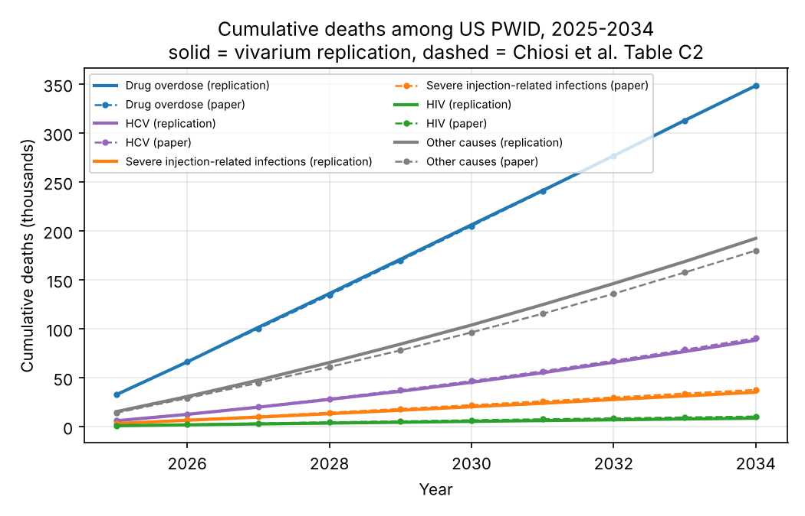
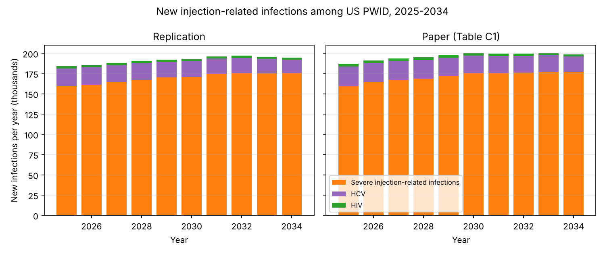
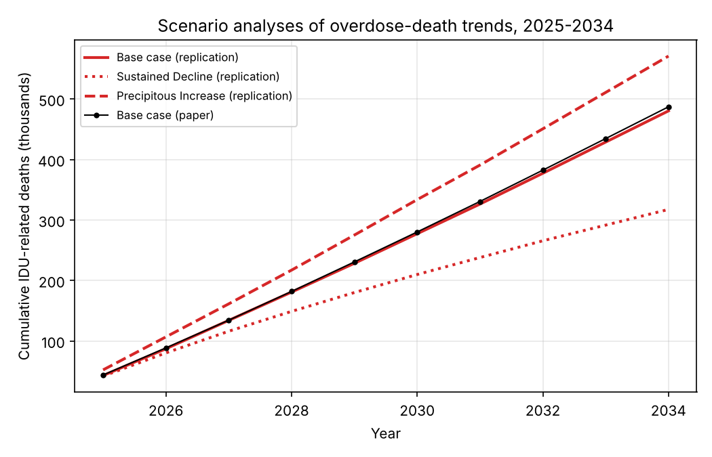
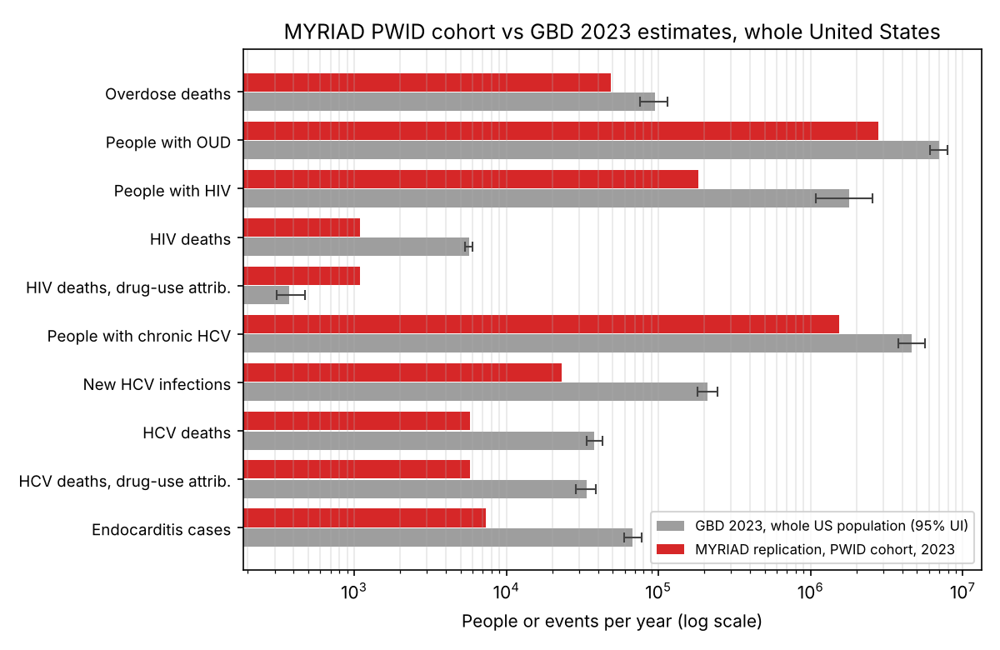

# Replicating the MYRIAD projections for US people who inject drugs (Chiosi et al. 2026) in vivarium

Target paper: Chiosi JJ, Giardina J, Wakeman SE, Freedberg KA, Chhatwal J,
Ciaranello AL. *Projected health and economic outcomes in people who inject
drugs in the United States, 2025-2034: A modeling study.* Open Forum Infect
Dis, 9 Oct 2026, [doi:10.1093/ofid/ofag675](https://doi.org/10.1093/ofid/ofag675)
(CC BY-NC-ND). The model, MYRIAD, was first described and validated in
[Chiosi et al. 2023, BMC Health Serv Res 23:760](https://doi.org/10.1186/s12913-023-09773-1).



## TL;DR

- **Tool choice: vivarium.** MYRIAD is a monthly individual-level
  microsimulation with no transmission dynamics, per-person costs and
  proportional cause-of-death attribution. That is a vivarium model almost
  line for line; camdl is for stochastic compartmental models fitted to time
  series and has nothing to fit here (see below).
- **The epidemiology replicates.** Running the paper's published inputs
  (Table 1 plus the 31 supplement tables) through the re-implementation
  reproduces the base-case 10-year totals for new severe injection-related
  infections (ratio 0.99), new HIV (0.96), overdose deaths (1.00), HCV deaths
  (0.98), total deaths (1.01) and the 2025 cohort size (3.24M vs the paper's
  3.25M), and the year-by-year curves (Figure 1). Both overdose scenarios
  reproduce the paper's reported effects on deaths to within 2% (-160k vs
  -158k; +87k vs +85k).
- **Two readings of the methods were needed to get there**, both documented
  as flags: people in remission keep the PWID infection inputs (otherwise
  infections fall 13-23% short), and an uncured bacterial infection keeps its
  in-hospital mortality until cure (otherwise case fatality is 1.75% instead
  of the paper's 2.2%).
- **What does not replicate: the cost split.** Drug-use costs come out 25%
  high, HIV costs 17% high and HCV costs 16% low, for a total of $680bn vs
  $565bn. The drug-use state mix is pinned by the overdose deaths (which
  match), so the gap is in how costs were accrued, which the paper does not
  describe in enough detail to resolve. Severe-infection costs match (1.00).
- **Two reported summary statistics cannot be reproduced from the paper's
  definitions**: "6.4 life-years per person" (the model gives 9.0 per 2025
  PWID; the paper's own death counts imply the same) and the per-person
  annual cost, which equals total cost / (3.254M x 10 years) in the paper's
  arithmetic.

## Results: base case, 2025-2034

Three seeds of 369,450 simulants each (one simulant per ten PWID); the paper
reports means of its own runs with a simulation SD of about 36k new
infections, 29k deaths and $2.7bn.

| Outcome, 2025-2034 | Paper | This replication (mean of seeds) | Seed SD | Ratio |
|---|---:|---:|---:|---:|
| PWID alive at start of 2025 | 3,300,000 | 3,243,760 | 2,710 | 0.98 |
| New severe injection-related infections | 1,714,773 | 1,694,783 | 4,417 | 0.99 |
| New HIV infections | 29,715 | 28,623 | 232 | 0.96 |
| New HCV infections or reinfections | 218,186 | 194,783 | 327 | 0.89 |
| Deaths: drug overdose | 348,650 | 348,313 | 540 | 1.00 |
| Deaths: severe injection-related infections | 37,658 | 35,243 | 106 | 0.94 |
| Deaths: HIV | 10,455 | 8,673 | 227 | 0.83 |
| Deaths: HCV | 90,486 | 88,263 | 601 | 0.98 |
| Deaths: other causes | 179,966 | 192,403 | 1,755 | 1.07 |
| Deaths: total | 667,216 | 672,897 | 1,482 | 1.01 |
| Costs, drug use ($bn, disc.) | 430.5 | 536.9 | 0.4 | 1.25 |
| Costs, severe infections ($bn) | 24.0 | 24.0 | 0.1 | 1.00 |
| Costs, HIV ($bn) | 77.2 | 90.5 | 0.6 | 1.17 |
| Costs, HCV ($bn) | 33.8 | 28.4 | 0.1 | 0.84 |
| Costs, total ($bn) | 565.4 | 679.7 | 0.3 | 1.20 |
| Average annual cost per person-year ($) | 17,375 | 20,955 | 25 | 1.21 |
| Life-years per person (per 2025 PWID) | 6.40 | 9.03 | 0.00 | 1.41 |

The annual series (paper supplement Tables C1-C3 vs replication) are in
`results/comparison_annual.csv`; Figures 1 and 2 plot them.



## Results: overdose scenarios



The paper reports the scenarios only as 10-year differences from the base case:

| Scenario | Δ deaths (paper) | Δ deaths (model) | Δ new infections (paper) | Δ new infections (model) | Δ overdose deaths (model) |
|---|---:|---:|---:|---:|---:|
| sustained_decline | -158,169 | -160,027 | +36,679 | +44,720 | -165,363 |
| precipitous_increase | +84,744 | +86,893 | -33,443 | -26,140 | +92,487 |

The Sustained Decline scenario's larger infection gain in the replication
(+45k vs +37k) follows from the cohort surviving longer at a slightly higher
per-capita infection rate than the paper's; the direction and the death
effects agree.

## How the model's inputs and outputs compare with GBD 2023

`gbd_comparison.py` sets the model's inputs and 2023 outputs beside the
IHME Global Burden of Disease 2023 estimates for the United States (pulled
with the GBD MCP tools; values and 95% uncertainty intervals are transcribed
in the script). The full table with notes is in `results/gbd_comparison.md`.
The main caveat is scope: MYRIAD follows 3.7 million people with active
injection drug use, whereas GBD estimates cover the whole US population, so
most rows compare a subset with a total.



| Quantity (2023) | MYRIAD, PWID cohort | GBD 2023, United States (95% UI) |
|---|---:|---:|
| People who inject drugs | 3.69M (2018 input); 3.37M alive in 2023 | 1.06% of males and 0.48% of females inject (2022 exposure), about 2.6M people |
| Opioid use disorder | 2.77M in the high-risk state | 6.99M (6.06M–7.96M) prevalent cases |
| Overdose deaths | 48,800 | 95,300 (76,100–115,300) drug-use-disorder deaths; 72,700 (57,800–89,700) opioid |
| Overdose death probability, people with OUD | 1.66% per year (input) | 72,697 / 6,990,364 = 1.04% per year |
| People with HIV | 183,000 | 1.80M (1.08M–2.55M); drug-use share of HIV disability 6.9% |
| HIV deaths | 1,090 | 5,676 (5,351–5,993); 376 (310–474) attributable to drug use |
| People with chronic HCV | 1.55M | 4.62M (3.77M–5.62M) |
| New HCV infections | 23,100 | 210,000 (180,000–244,000) acute infections |
| HCV-related deaths | 5,800 | 37,964 (33,634–42,777); 33,769 (28,456–38,580) attributable to drug use |
| Endocarditis | 7,310 hospitalisations, about 420 deaths | 67,728 (59,676–77,844) cases; 9,450 (8,160–10,666) deaths |

What the comparison says:

- **Overdose deaths are consistent.** The model's 48,800 overdose deaths
  among PWID in 2023 are 51% of GBD's 95,300 drug-use-disorder deaths, close
  to the 45.1% injection share the paper applies to national counts; in 2018
  the model's 30,200 compares with GBD's 62,900.
- **The OUD population is a subset.** The 2.8 million people the model holds
  in the OUD state are 40% of GBD's 7.0 million prevalent cases, and their
  overdose death probability (1.66% per year in 2023) is above the 1.04% per
  year implied by GBD's deaths and prevalence, as expected for the injecting
  subset. The 2023 model paper calibrated against an NSDUH-based 22.8 million
  people misusing opioids (2015), with 35% OUD, which is about twice GBD's 2015
  OUD count of 4.3 million.
- **The number of PWID is the largest input disagreement.** Bradley et al.'s
  3.7 million (past-year injection, the model's cohort) exceeds the 2.6 million
  implied by GBD's injected-drug-use exposure proportions, and the paper's
  sensitivity range (1.9M–7.3M) spans both.
- **HIV: the model carries more HIV among PWID than GBD attributes to drug
  use.** Its 183,000 people with HIV among PWID are a tenth of GBD's 1.8
  million US prevalence, while GBD puts only 6.9% of HIV disability and 6.6%
  of HIV deaths on drug use; the model's 1,090 HIV deaths among PWID are
  three times GBD's 376 drug-use-attributable HIV deaths. The paper's own
  introduction cites "nearly 100,000 PWID living with HIV", half its 5.12%
  input.
- **HCV: the burden sits mostly outside the active-IDU cohort.** GBD
  attributes 89% of the 38,000 US HCV-related deaths to drug use (lifetime
  injection), but the model's active injectors account for 5,800 of them;
  the rest fall among older former injectors the closed cohort does not
  include. The model's 1.55 million chronic infections are a third of GBD's
  4.6 million, and its 23,000 new infections a ninth of GBD's 210,000 acute
  infections (CDC's estimate, about 67,000, is far below GBD's).
- **Endocarditis is in range.** PWID account for about a tenth of GBD's
  67,700 US endocarditis cases, in line with published injection-associated
  shares; osteomyelitis, CNS abscess and SSTI hospitalisations have no
  comparable GBD cause.
- **Background mortality checks out.** The supplement's cause-deleted life
  table, cumulated to five-year probabilities, is below GBD's 2023 all-cause
  q(x) at ages 25-49 (where drug, HIV and HCV deaths are concentrated and
  were removed) and matches it within 2 per 1,000 from age 50 (`results/gbd_comparison.md`).
  All-cause mortality in the simulated cohort runs at 21.5 per 1,000
  person-years in 2023, about eight times the general-population rate at the
  cohort's mean age.

## Where the two readings of the methods matter

Sensitivity runs (100,000 simulants, seed 0) with the alternative readings:

| 10-year outcome | Paper | Default | Remission on non-IDU infection inputs | SBI mortality in hospitalisation month only |
|---|---:|---:|---:|---:|
| New severe infections | 1,714,773 | 1,694,783 | 1,444,697 | 1,714,248 |
| New HIV | 29,715 | 28,623 | 23,830 | 28,411 |
| New HCV | 218,186 | 194,783 | 166,954 | 195,402 |
| Deaths, severe infections | 37,658 | 35,243 | 29,113 | 28,189 |
| Deaths, HIV | 10,455 | 8,673 | 8,534 | 9,162 |
| Deaths, total | 667,216 | 672,897 | 670,441 | 670,219 |

The 2023 model paper describes remission as a "former IDU" state carrying
non-IDU infection risk, and infection-type mortality as applying "only in the
month the infection occurs". The 2026 results are consistent only with the
readings used by default here; the supplement's own wording ("not engaging in
active IDU") is ambiguous about infection risk, and the 2026 model may simply
differ from the 2023 one.

## What remains unexplained

1. **Drug-use costs (+25%).** The paper's 2025 figure, $53.5bn, is $1,370 per
   person-month. With 83% of the cohort in the high-risk state ($1,791/month
   plus $115 syringe cost) and 16% in remission ($765), the inputs give
   $1,715. The state mix cannot be the difference: the overdose deaths, which
   depend on the same mix, match the paper to 1%. Dropping the syringe cost
   or discounting from 2018 instead of 2025 each closes part of the gap, but
   neither is stated and the severe-infection cost per hospitalisation
   ($16.0k implied by the paper, $16.2k from Table 1) rules out a hidden
   discount factor.
2. **HIV costs (+17%) and HIV deaths (-17%).** Both point the same way: the
   replication keeps more people with HIV on ART (56% from 2021 on, 38% with
   CD4 < 200) than the paper. The ART start/stop inputs are reproduced as
   printed; the paper may apply them differently (for example only to people
   diagnosed during the simulation).
3. **HCV costs (-16%) while HCV deaths match (0.98).** Deaths pin the
   decompensated-cirrhosis and HCC pools, so the paper's higher cost per
   person with HCV ($218 vs $156 per month in 2025) must come from the
   cheaper stages or from costing people who cleared infection; neither is
   described.
4. **New HCV infections (-11%).** Incidence applies to the HCV-negative pool;
   the paper's 2025 count implies a pool equal to the initial 56.5% of the
   cohort, as if no net depletion occurred over 2018-2024.
5. **Other-cause deaths (+7%)**, with the same life table: an ageing
   difference, possibly an age cap.
6. **Life-years per person: 9.0 vs 6.4.** The paper's 667k deaths in a 3.25M
   cohort cannot produce fewer than about 9 life-years per person over 10
   years, so the paper's figure uses some other definition.


## Why vivarium rather than camdl

MYRIAD is an individual-level, monthly-cycle microsimulation: every simulated
person carries an age, sex, drug-use state, HIV state (infection, diagnosis,
ART, CD4 stratum), HCV state (infection, acute/chronic, METAVIR stage), an
active-bacterial-infection flag, and per-event and per-state costs that are
discounted by calendar year. Cause of death is drawn in proportion to the
person's cause-specific hazards. There is no transmission: incidence is an
exogenous calendar schedule. That is exactly the shape of a
[vivarium](https://github.com/ihmeuw/vivarium) model: one component per
condition owning its own state columns, a value pipeline that pools the
cause-specific death probabilities, and an observer that tallies events and
costs by year. Each of the paper's input tables becomes a few lines of a
component.

[camdl](https://github.com/vsbuffalo/camdl) is built for stochastic
*compartmental* models with likelihood-based inference against time series
(see `../camdl_replication/`). MYRIAD could in principle be flattened into
compartments, but the product state space (4 drug states x 13 HIV states x
15 HCV states x 2 infection flags x age x sex) runs to tens of thousands of
strata, and camdl has no notion of per-person costs, discounting, or
proportional cause-of-death attribution. There is also nothing to infer: the
paper's only calibrated inputs (five drug-use transition probabilities) are
published as point values. vivarium gives the simpler and more faithful
replication, so that is what this directory uses.

## What the model does

One time step is one month. The cohort is closed: 3,694,500 PWID in January
2018 (the paper's input year), aged through 2024 so that about 3.3 million
remain in January 2025, then followed to December 2034. Outcomes are reported
for 2025-2034 and scaled from `n` simulants to the national cohort.

| Component (`myriad/components.py`) | State | Transitions each month |
|---|---|---|
| `Population` | age (N(40, 10) truncated 18-65), sex (29.7% female) | ageing |
| `DrugUse` | low / medium / high risk, remission | S-B2 transition probabilities; overdose death by state and calendar year (S-B3; S-B5/S-B6 for the scenarios) |
| `HIV` | infected, diagnosed, on ART, CD4 (>=500, 200-499, <200) | incidence by year and IDU status (S-B11), testing (S-B17), ART start at diagnosis and monthly start/stop by CD4 (S-B14/18), CD4 progression by regimen (S-B16), HIV death (S-B21) |
| `HCV` | infected, months since infection, METAVIR F0-F4 / decompensated cirrhosis / HCC | incidence by year (S-B23), spontaneous clearance in the acute phase, fibrosis progression with HIV relative risks (S-B20, S-B25), liver death (S-B26) |
| `SevereBacterialInfection` | uncured infection flag; this month's hospitalisation type | hospitalisation hazard rising linearly (S-B7, Eq. 8) times an HIV/CD4 odds ratio (S-B19); type split (T1); in-hospital death (S-B8); cure unless self-directed discharge (S-B9) |
| `Mortality` | alive, cause of death | background mortality by single-year age and sex (S-B27) plus the four cause-specific probabilities; rates summed, cause drawn in proportion |
| `OutcomeObserver` | - | events, deaths by cause, person-months, costs by category (S-B28-B31) |

"S-Bn" refers to the supplement tables and "T1" to the main-text Table 1; every
value in `myriad/parameters.py` carries that citation.

## Assumptions where the paper is silent or inconsistent

1. **SBI hospitalisation trend.** Supplement Eq. 8 prints an intercept
   (59,664) that contradicts both the 2017 observed count (94,068) and Table
   1's 2.7% for 2018. Using the 2017 count as the intercept reproduces Table 1
   exactly, so the model uses 94,068 + 5,532 x (year - 2017) hospitalisations
   per 3,694,500 PWID, and lets the line continue through 2034 (the supplement
   says the projection covers "2018-2023"). The paper's own SBI counts rise 11%
   over 2025-2034 while the cohort shrinks by a fifth, which requires exactly
   such a rising per-capita rate.
2. **HIV and HCV incidence after the last surveillance year** (2024 and 2023)
   are held flat. Table 1 says incidence was "extrapolated thereafter" without
   saying how; flat extrapolation reproduces the paper's per-capita HIV
   incidence in 2025 to within 2%.
3. **Spontaneous HCV clearance** is not in the 2026 supplement. The 2023
   model paper lists 2.4% per month (Grebely et al.); applying it during the
   first 12 months of infection gives the roughly 25% one-year clearance that
   source reports. Cleared people keep their fibrosis stage and progress from
   F4 at the "without HCV" rates.
4. **Remission is treated as non-injecting** ("not engaging in active IDU"),
   so people in remission use the non-IDU incidence, testing, ART and
   self-discharge inputs, pay no syringe cost, and carry the remission overdose
   rate.
5. **Initial HCV-infected people are chronically infected** (past the acute
   window); prevalent decompensated cirrhosis is treated as beyond its first
   year.
6. **Costs accrue for everyone alive at the start of a month**, including
   those who die during it; the overdose-death and hospitalisation costs are
   one-off. Costs are discounted at 3% per year to 2025 by calendar year, as
   in the paper's annual tables.
7. **Sequential within-month updating** in the order ageing, drug use, HIV,
   HCV, bacterial infection, death. The paper does not state its order.

## Running it

```bash
cd myriad_pwid_vivarium_replication
uv sync
uv run pytest -q                      # ~10 s
uv run python run_replication.py --n 100000 --seeds 0 --scenarios base   # ~4 min
uv run python plot_results.py
```

`run_replication.py` writes monthly and annual CSVs, `summary.csv`, and the
comparison tables under `results/`. The full runs reported above were five
separate invocations (`--n 369450`, about 7 minutes each on one core; base
case seeds 0-2 and the two scenarios with `--tag _full_...`) combined with
`--aggregate _full_base0 _full_base1 _full_base2 _full_sd _full_pi`. The
sensitivity columns come from `MYRIAD_REMISSION_NON_IDU=1` and
`MYRIAD_SBI_MONTH_ONLY=1` with `--n 100000`.

## Files

- `myriad/parameters.py` - every input with its source table
- `myriad/components.py` - the vivarium components
- `myriad/simulation.py` - builds the simulation, scales and discounts results
- `myriad/data/background_mortality_monthly.csv` - supplement Table B27
- `run_replication.py`, `plot_results.py`, `test_myriad.py`
- `gbd_comparison.py` - model vs GBD 2023 comparison tables and figure
- `explainer.html` - standalone explainer page with interactive charts (open in a browser)
- `results/` - CSV outputs, comparison tables and figures
