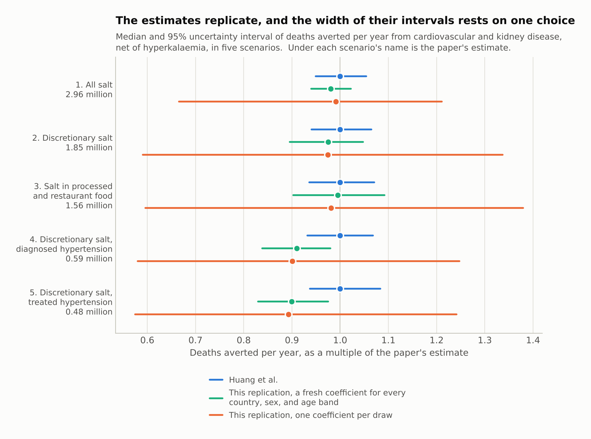
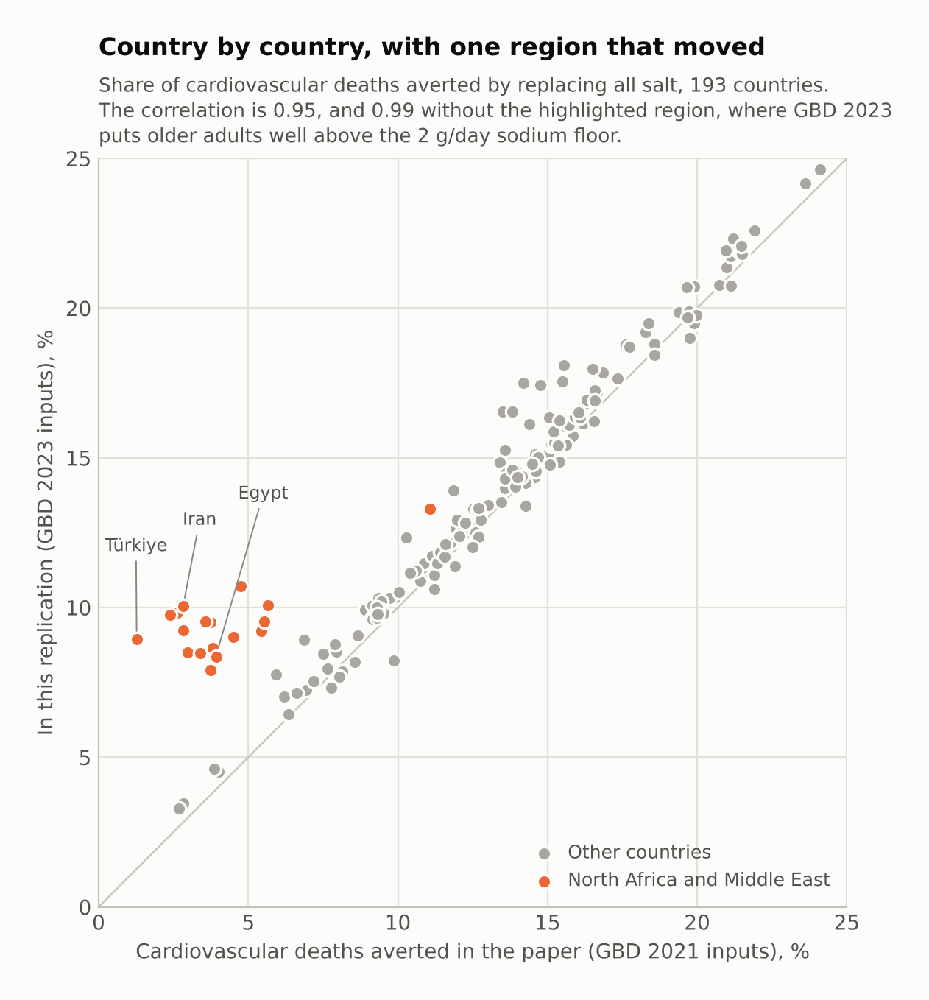
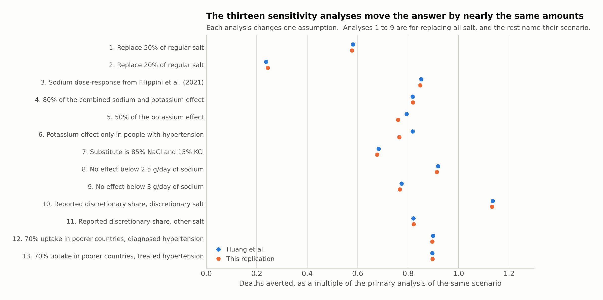
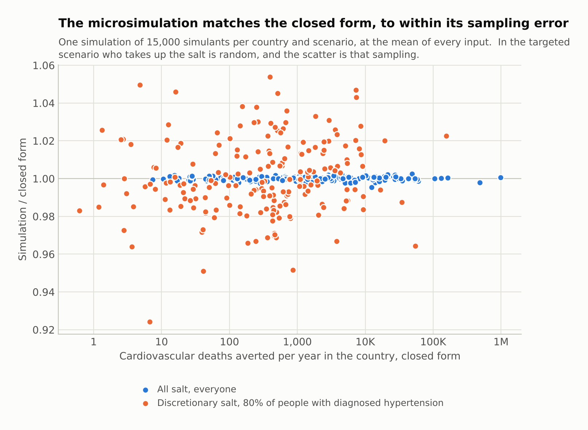

# Potassium-enriched salt in 193 countries: a vivarium replication of Huang et al. (2026)

Huang and colleagues estimate that replacing regular salt with a blend that is one
quarter potassium chloride would avert about 3 million deaths a year worldwide
([*Nature Health*, 2026](https://doi.org/10.1038/s44360-026-00216-9)). Their code is
shared on request and may not be redistributed. This directory therefore rebuilds
the model from the paper and its supplement, as a
[vivarium](https://vivarium.readthedocs.io/) microsimulation, and runs it on GBD 2023
where the paper used GBD 2021.



## TL;DR

- **The point estimates replicate.** Replacing all salt averts 2.93 million deaths a
  year here and 2.96 million in the paper. The other four scenarios come within 11%,
  and the two that target people with hypertension come out lowest.
- **So do the thirteen sensitivity analyses**, most of them to the second decimal
  place when each is expressed relative to its primary analysis.
- **The uncertainty intervals replicate under one reading only.** I can match the
  paper's interval of about ±5% only by drawing every dose-response coefficient afresh
  for each country, sex, and age band. With one value of each coefficient per draw,
  the interval for all salt runs from 1.97 to 3.58 million.
- **One region does not replicate, and the data are why.** In North Africa and the
  Middle East I avert three times the share of deaths that the paper does, because
  GBD 2023 has sodium intake at older ages there well above the 2 g/day below which
  the model allows no benefit.
- **Not attempted:** non-fatal events and DALYs. The GBD connector I used caps the
  rows it serves in a day, and I spent them on deaths.

What is here: a vivarium model of a static comparative risk assessment (components, a
model specification, observers), a `vivarium_inputs`-shaped stub over a cached GBD
2023 extract with the swap to the real package marked, a closed-form version of the
same model that checks the simulation and carries the uncertainty, and a test suite
and notebook that run on made-up inputs.

## The model in six lines

```python
from vivarium_potassium_salt.tools import run_simulation

baseline = run_simulation.simulate("China", "baseline")["burden"]
all_salt = run_simulation.simulate("China", "all_salt")["burden"]   # same seed, same simulants

rate = "ischemic_heart_disease.cause_specific_mortality_rate"
by_stratum = lambda table: table.groupby(["sex", "age_group"], observed=True)[rate].sum()
1 - by_stratum(all_salt) / by_stratum(baseline)    # share of deaths averted, by sex and age
```

Each call is one vivarium simulation of 15,000 simulants for one year. The two share
a random seed, so they share their simulants, and one minus the ratio of their summed
death rates is the share of deaths averted. This comes to 31% for ischaemic heart
disease among Chinese men aged 60 to 64, at the central value of every input. (This needs the
cached GBD extract. The [quickstart](#quickstart) runs the same thing on made-up
inputs.)

## The problem

Take that man in China. By GBD's estimate he takes in 7.5 g of sodium a day. If a
quarter of his salt becomes potassium chloride he takes in 1.9 g less sodium and
2.5 g more potassium, because the two salts replace each other gram for gram. Trials
say his systolic blood pressure should fall by about 4 mmHg for the sodium (6 if he
has hypertension) and 6.5 mmHg for the potassium, and at his age each 10 mmHg
multiplies his risk of dying of ischaemic heart disease by 1.41. Carry that through
the distribution of blood pressure among men like him and 31% of their deaths from
ischaemic heart disease do not happen.

The paper does this arithmetic for 193 countries, two sexes, fifteen age bands, and
thirteen causes of death, with 1,000 Monte Carlo draws, under five scenarios:

1. everyone replaces all their salt, at the table and in processed food;
2. everyone replaces "discretionary" salt, the salt added at the table and in cooking;
3. everyone replaces the rest, the salt in processed and restaurant food;
4. 80% of people with diagnosed hypertension replace discretionary salt;
5. 80% of people with treated hypertension do.

The question is not trivial because of the kidneys. People with advanced chronic
kidney disease do not clear extra potassium, and a high serum potassium can stop the
heart. The model therefore also counts the cardiovascular deaths that the extra
potassium would cause among people with kidney disease stages 3 to 5, and subtracts
them. The
unfortunate arithmetic of public health is that the same spoonful helps most people
a little and may hurt a few people a lot.

## What the paper specifies, and what I had to guess

The paper and its 93-page supplement give every parameter. They do not give the
code, and I had to choose a reading in four places. I list them because each is a
place where another reader would get another answer.

- **How hypertension lines up with blood pressure.** Scenarios 4 and 5 reach only
  people with hypertension, and the answer depends on whether those people sit at
  the top of the blood pressure distribution. I assume hypertension is independent
  of blood pressure within a stratum, which is crude, and also run the other extreme,
  in which the people with hypertension are exactly those with the highest pressure.
  The paper's results fall between the two, nearer the first.
- **How cardiovascular deaths are divided among kidney disease stages.** One reading
  of the parent model's equation reproduces the paper's hyperkalaemia deaths and the
  other gives 60% more. I use the first.
- **Whether a dose-response coefficient is drawn once per draw or once per stratum.**
  This one changes the width of every interval by a factor of five, and it has its
  own section below.
- **Small things.** The standard deviation of blood pressure is rebuilt from a
  regression in the GBD methods appendix, the intercept of the discretionary-salt
  regression is refit from a digitised figure, and a floor of 5% on the discretionary
  share is inferred from the paper's results for rich countries.

## A vivarium model of a model with no time in it

The paper's model is a comparative risk assessment. For each country, sex, and age
band it computes one number per cause, the share of deaths averted, and multiplies it
into the GBD death count. Nothing happens over time, which makes it an odd guest in a
framework built to step simulants through their lives. I have used vivarium anyway,
because the framework's habits carry over to a static model with little strain:
inputs arrive through an artifact, each idea is one component, the baseline and the
scenario share their random numbers, and observers do the adding up.

| Piece of the model | Component | Whose code |
|---|---|---|
| 15,000 simulants, 500 per sex and five-year age band | `AdultPopulation` | mine |
| Systolic blood pressure, from the GBD exposure distribution | `Risk('risk_factor.high_systolic_blood_pressure')` | `vivarium.public_health`, unchanged |
| Sodium intake, and the share of it that is discretionary | `DietarySodium` | mine |
| Hypertension: none, undiagnosed, diagnosed, treated | `HypertensionStatus` | mine |
| Who uses the substitute, and what it does to their sodium, potassium, and blood pressure | `PotassiumEnrichedSalt` | mine, as a modifier on the stock exposure pipeline |
| Annual death rate from each of 13 causes | `CauseBurden` | mine |
| Relative risk of each cause above the TMREL | `SampledTmrelRiskEffect` | the stock `RiskEffect`, subclassed in a dozen lines so that the TMREL varies by draw |
| Kidney disease stage, serum potassium, and hyperkalaemia risk | `ChronicKidneyDisease` | mine |
| Sums of rates by age, sex, kidney disease stage, and hypertension status | `BurdenObserver`, `SaltPolicyObserver` | mine, on the stock results interface |

Three choices need a sentence each. The simulation takes one step of one year and
nobody dies in it: each simulant carries a death rate for each cause, and the
observers add up rates, which gives the expected number of deaths without the noise
of drawing them. The baseline and each scenario are separate simulations with the
same seed, so they hold the same simulants, and one minus the ratio of their summed
rates is the potential impact fraction. Simulants are allocated equally to age bands
and not in proportion to population, because the oldest bands hold most of the
deaths and few of the people, and each stratum's fraction is applied to its GBD
death count afterwards.

The static design has a second payoff. With blood pressure gamma distributed and a
log-linear relative risk, the average that the simulation estimates has an exact
expression in incomplete gamma functions, and
[`analytic.py`](src/vivarium_potassium_salt/analytic.py) evaluates it for every
stratum, cause, and draw at once. I use this closed form to check the simulation,
with which it shares the dose-response arithmetic and nothing else, and to carry the
uncertainty. A thousand draws of all 193 countries take minutes in closed form, and
would take about two weeks through the simulation on the four cores I had (on a
cluster they are what `psimulate` is for).

## Results

### Deaths averted

Deaths averted per year, in millions, from cardiovascular and chronic kidney disease
together, net of the deaths that hyperkalaemia adds:

| Scenario | Paper | Simulation, mean inputs | Median (95% UI), one coefficient per draw | Median (95% UI), one coefficient per stratum |
|---|---|---|---|---|
| 1. All salt | 2.96 (2.81 to 3.12) | 3.13 | 2.93 (1.97 to 3.58) | 2.90 (2.78 to 3.03) |
| 2. Discretionary salt | 1.85 (1.74 to 1.97) | 1.84 | 1.80 (1.09 to 2.47) | 1.80 (1.66 to 1.94) |
| 3. Salt in processed and restaurant food | 1.56 (1.46 to 1.67) | 1.59 | 1.53 (0.93 to 2.15) | 1.55 (1.41 to 1.70) |
| 4. Discretionary salt, 80% of diagnosed hypertension | 0.59 (0.55 to 0.63) | 0.54 | 0.53 (0.34 to 0.74) | 0.54 (0.49 to 0.58) |
| 5. Discretionary salt, 80% of treated hypertension | 0.48 (0.45 to 0.52) | 0.44 | 0.43 (0.28 to 0.60) | 0.43 (0.40 to 0.47) |

The simulation column is one vivarium run of every country at the mean of each input.
The other two columns are the closed form at 1,000 draws, which is the like-for-like
comparison with the paper's medians. The mean-input column is about 7% above the
medians for all salt. This is the work of the model's ceilings and floors (the
potassium effect is capped, the sodium effect is cut off at zero, intake stops at
2 g/day): a capped function of an average is larger than the average of the capped
function.

For the three scenarios that reach everyone, my medians are 1 to 3% below the
paper's. This is closer than the inputs deserve. GBD 2023 has 4% fewer cardiovascular
deaths among adults in 2021 than GBD 2021 did (18.0 against 18.8 million, with 15%
fewer in China and 9% more in India). I avert a share of them that is 3% larger
(15.4% against 14.9%), so two differences of a few percent mostly cancel. By sex, I
avert 1.08 million cardiovascular deaths among women and 1.70 million among men,
against the paper's 1.13 and 1.66 million.

The two scenarios that target hypertension come out 10% low, and I can name about
half of that gap. A comparative risk assessment has one blood pressure distribution
per stratum, and when only some of the people in a stratum change their salt it has
to move the whole distribution by the stratum's average fall. The simulation moves
each simulant by their own fall, which is zero for most of them and several mmHg for
the few who switch. The relative risk is convex, so the first way always averts more
(this is Jensen's inequality at work), and the closed form run that way gives 0.56
and 0.45 million. The rest of the gap I cannot assign. If the people with
hypertension were exactly those with the highest blood pressure in each stratum I
would get 0.69 and 0.56 million, well above the paper. Its model therefore sits
somewhere in the short distance between independence and that. The number of people reached does
match: 662 and 526 million at mean inputs, against the paper's 659 and 524 million.

### Country by country



Across 193 countries the share of cardiovascular deaths averted by replacing all
salt has a correlation of 0.95 with the paper's, and 0.99 without the 20 countries of
North Africa and the Middle East. Outside that region my share is a median 3% above
the paper's, and within 10% of it in 86% of countries. In the countries where the
paper averts the most deaths the two are close: 20.8% against 20.7% in China, 14.3%
against 13.6% in India, 11.2% against 10.4% in the United States.

| GBD super-region | Cardiovascular deaths, GBD 2023 / GBD 2021 | Averted in the paper, % | Averted here, % | Ratio |
|---|---|---|---|---|
| Central Europe, Eastern Europe, and Central Asia | 0.98 | 13.9 | 14.3 | 1.03 |
| High-income | 0.98 | 10.5 | 10.9 | 1.04 |
| Latin America and Caribbean | 1.04 | 14.3 | 14.7 | 1.03 |
| North Africa and Middle East | 0.98 | 3.2 | 9.0 | 2.82 |
| South Asia | 1.06 | 13.7 | 14.3 | 1.05 |
| Southeast Asia, East Asia, and Oceania | 0.88 | 20.5 | 20.9 | 1.02 |
| Sub-Saharan Africa | 0.96 | 11.1 | 11.7 | 1.05 |
| All 193 countries | 0.96 | 14.9 | 15.4 | 1.03 |

North Africa and the Middle East is the exception, and an instructive one. I avert
9.0% of cardiovascular deaths there and the paper 3.2%. Among women the paper averts
almost nothing (0.4%, and 0.0% in Türkiye). This means that its GBD 2021 inputs had
them at or below 2 g/day of sodium, the floor below which the model allows no
benefit, at every age. GBD 2023 has sodium intake in this region rising steeply after
age 70: women in Türkiye are at 1.7 g/day at ages 65 to 69 and at 3.0 g/day at 80 to
84. About half of the region's cardiovascular deaths come at 75 and over. I have
not seen the GBD 2021 values, so this is an inference from the paper's results and
not a comparison of inputs. What it shows is how much rides on the floor: a revision of a gram or two a
day, in the oldest age bands of one region, is worth 70,000 deaths averted a year.

### The intervals

This is the result I did not expect.

A dose-response coefficient is one unknown number. If the true effect of sodium on
blood pressure is smaller than the meta-analysis says, it is smaller in Norway and in
Nigeria, in men and in women, at 40 and at 80. A Monte Carlo draw should therefore
use one value of each coefficient everywhere. When I do that, the 95% interval for
replacing all salt runs from 1.97 to 3.58 million deaths, about five times as wide as
the paper's 2.81 to 3.12 million.

I can reproduce the paper's intervals only by drawing a fresh value of every
coefficient for each of the 5,790 combinations of country, sex, and age band, so that
the errors average out in the sum (2.78 to 3.03 million). The supplement says that a
draw of each parameter was made "for each simulation", and does not say at what
level. The evidence is in how the intervals narrow as strata are added up:

| Width of the 95% interval, relative to the median | Paper | Here, one coefficient per stratum | Here, one coefficient per draw |
|---|---|---|---|
| A country and sex (median of the 40 largest) | 37% | 34% | 68% |
| The world | 11% | 9% | 55% |

With one coefficient per draw the interval for the world is nearly as wide as the
interval for a single country and sex, because the dominant uncertainty is the same
in both. With one per stratum it is four times narrower, and the paper's is three and
a half times narrower. The paper also samples a few inputs that I do not (the
standard deviation of blood pressure, population, the prevalence of kidney disease).
This is probably why its intervals are a little wider than my narrow ones.

This is an inference from published intervals and not a reading of code, and I would
be glad to be shown wrong. It does not touch the paper's central estimates, and it
does not overturn the conclusion: the lower end of the wide interval is still two
million deaths a year. Neither of my columns is the last word, either. In both, the
GBD inputs are drawn independently for every stratum, because the connector serves
intervals and not draws, where real GBD draws are correlated across ages and
countries. Even the wide interval is therefore too narrow.

### Sensitivity analyses



The paper reports thirteen sensitivity analyses, each of which changes one
assumption. Expressed as a multiple of the primary analysis of the same scenario,
mine agree with the paper's to within 0.01 in eleven of them. Replacing half the salt
gives 0.58 in both, a 15% potassium chloride blend 0.68 in both, and a sodium floor
of 3 g/day 0.77 in both. The two exceptions are the analyses that weaken the
potassium effect (5 and 6), where I lose 24% of the benefit and the paper 18 to 21%.
Potassium therefore carries somewhat more of the benefit in my model than in the
paper's, and I do not know why. The numbers behind the figure are in
[`results/comparison/sensitivity.csv`](results/comparison/sensitivity.csv).

### Kidney disease

| All salt, millions | Paper | Here |
|---|---|---|
| People with kidney disease stages 3 to 5 | 239 | 268 |
| Cardiovascular deaths prevented among them | 0.75 (0.71 to 0.80) | 0.94 (0.66 to 1.17) |
| Cardiovascular deaths caused by hyperkalaemia | 0.10 (0.09 to 0.11) | 0.10 (0.01 to 0.28) |

This half of the model replicates less well, and most of the reason is an input I
did not have. The connector's daily cap ran out before the country estimates of
kidney disease prevalence arrived, so every country here has the global prevalence
of each stage for its age and sex. This adds up to 268 million people where the
paper has 239 million. The deaths prevented by lower blood pressure among them are
25% above the paper's. The deaths caused by hyperkalaemia match, but only under one
of two readings of how the parent model divides deaths among kidney disease stages.
The other reading gives 0.15 million, and I chose the one that matched, which is a
weaker kind of replication than the rest of this page.

### Does the simulation compute what the closed form says?



At the mean of every input, the simulation's total for the 193 countries is within
0.02% of the closed form's in each scenario that reaches everyone, and within 0.2% of
it in 95% of countries. In the targeted scenarios, where who takes up the salt is
random, the totals agree to about half a percent and single countries to about 5%.
For the ten countries with the most cardiovascular deaths I also ran three sampled
draws of the inputs. The ratio of simulation to closed form for all salt stayed
between 0.995 and 1.004 in all thirty runs. The kidney disease quantities are
noisier, about 6% in a single country, because they rest on the few hundred simulants
with advanced kidney disease. One of them, the deaths prevented among people with
kidney disease, also comes out 1% high in the world total, which I take to be the
small-sample bias of a ratio.

This agreement is a check on wiring and not on truth. The two implementations share
the dose-response arithmetic in
[`components/intervention.py`](src/vivarium_potassium_salt/components/intervention.py),
so an error there would pass unnoticed by this comparison, and the test suite checks
that file against numbers worked by hand.

## GBD 2023 through a `vivarium_inputs` stub

On the IHME cluster a vivarium model gets its inputs by handing a `gbd_mapping`
entity to `vivarium_inputs.get_measure`. That package does not install beside the
current vivarium packages off the cluster, and its data access is internal. In its
place,
[`data/vivarium_inputs_stub.py`](src/vivarium_potassium_salt/data/vivarium_inputs_stub.py)
offers the same functions with the same arguments and return shapes, and answers
them from a cached extract of GBD 2023. The loader is written against that interface:

```python
from vivarium.gbd_mapping import causes, risk_factors
from vivarium_potassium_salt.data import vivarium_inputs_stub as interface
# on the cluster:  from vivarium_inputs import interface

interface.get_measure(causes.ischemic_heart_disease, "cause_specific_mortality_rate", "China")
interface.get_measure(risk_factors.high_systolic_blood_pressure, "exposure", "China")
interface.get_measure(risk_factors.diet_high_in_sodium, "exposure", "China")
```

The swap is the one import at the top of
[`data/loader.py`](src/vivarium_potassium_salt/data/loader.py). I have not been able
to run the swapped version, so read it as a marked seam and not as tested code.

| Request | Answered here from |
|---|---|
| 13 causes, `cause_specific_mortality_rate` | GBD 2023 deaths and population |
| `high_systolic_blood_pressure`, `exposure` | GBD 2023 mean systolic blood pressure |
| the same, `exposure_standard_deviation` | the regression in the GBD 2023 methods appendix, because the connector does not serve it |
| the same, `exposure_distribution_weights` | all the weight on the gamma, the paper's distribution |
| the same, `relative_risk` | GBD 2019 log-linear relative risks, from the appendix to Marklund et al. (2020) |
| `diet_high_in_sodium`, `exposure` | GBD 2023 sodium intake, g/day |
| `kidney_dysfunction`, `exposure` | GBD 2023 global prevalence of kidney disease stages 3, 4, and 5 by age and sex, used for every country |
| `gdp_per_capita_base_2010`, `estimate` | World Bank, and IMF where the Bank has no figure |

The extract came through IHME's GBD MCP connector, which serves GBD 2023 results and
caps a user at 50,000 rows a day. It also caps full-precision CSV at 10,000 rows a
day, a second cap that I found by running into it. The pull plan in [`gbd_pull/`](gbd_pull) spends
the rows where they matter. Sodium and blood pressure come for every country, sex,
and age band. Deaths come that way for the three largest causes, which are three
quarters of the deaths in the model. For the other ten they come as country totals
for ages 25 and over, which the extract spreads over ages with the age pattern of
the country's GBD super-region. Four small causes (3% of deaths) borrow the age pattern
of a neighbouring cause, because the pull stopped before theirs arrived.

The stub differs from the real interface in two ways that matter. The connector
serves a mean and a 95% interval, not draws, so the stub's draws are sampled
independently for every stratum, where real GBD draws are correlated across ages and
countries. And it knows one year, 2021, and only the measures this model uses.

## Quickstart

```bash
cd potassium_salt_replication
uv sync
uv run pytest
```

The tests build two made-up countries in the layout of the real inputs, run the
artifact builder, the simulation, and the closed form on them, and take about half a
minute. [`tutorial.ipynb`](tutorial.ipynb) walks through the same pipeline one step
at a time, from a `get_measure` call to a share of deaths averted.

## Reproducing the numbers

Two inputs are not in the repository. The GBD extract (`data/gbd_2023/`) has to be
pulled again with [`gbd_pull/`](gbd_pull), or replaced by the real `vivarium_inputs`
on the cluster. NCD-RisC states no licence for its data files, so its hypertension
estimates are fetched and tidied by
[`inputs/prepare_hypertension.py`](inputs/prepare_hypertension.py). With both in
place:

```bash
uv run python -m vivarium_potassium_salt.data.builder --all --jobs 4      # 193 artifacts, 3 minutes
uv run python -m vivarium_potassium_salt.tools.run_simulation --all --jobs 4 \
    --checkpoint-dir results/simulation/draw_0_parts \
    --output results/simulation/draw_0.parquet                            # 1,158 simulations, 25 minutes
uv run python -m vivarium_potassium_salt.tools.run_closed_form --draws 1000 --jobs 4
uv run python -m vivarium_potassium_salt.tools.compare_with_paper
uv run python -m vivarium_potassium_salt.tools.make_figures
```

One simulation also runs under vivarium's own command line:
`simulate run src/vivarium_potassium_salt/model_specifications/model_spec.yaml -i artifacts/china.hdf -o out/`.

## Using the pattern for another risk factor

Nothing in the design is specific to salt. A static comparative risk assessment in
vivarium needs a stock `Risk` for the exposure, one `CauseBurden` and one `RiskEffect`
per outcome, an intervention component that registers a modifier on the exposure
pipeline, and the two observers. To ask the same kind of question about another
exposure, replace `PotassiumEnrichedSalt` with a component that says how much each
simulant's exposure moves, and change the lists in the model specification. The
closed form is the part that does not transfer for free, since it leans on the gamma
distribution and the log-linear risk.

## What remains open

The largest gap is the part I did not attempt. Non-fatal events and DALYs need GBD
inputs that I did not pull. `CauseBurden` and the observers already accept
`incident_cases` and `dalys`, and the extract reader already knows how to spread
country totals over ages. This is therefore a day of connector quota and a few more
lines of model specification, and not new code.

Kidney disease prevalence by country is the second gap, and filling it would
probably close most of the 25% excess in deaths prevented among people with kidney
disease.

Real GBD draws are the third, and the most interesting. On the cluster the one-line
change in `data/loader.py` replaces my independent pseudo-draws with draws that are
correlated across ages and locations, and the uncertainty interval will widen again,
by an amount I cannot guess from here.

The model itself is a static one-year calculation, as the paper's is. A vivarium
model would more naturally let blood pressure act on incidence and let deaths follow
over the years, with people ageing into and out of risk. That answers a different
question from the paper's (how many deaths would be averted in the long run, and how
soon), and it is a promising one to ask with these components.

## Files

- [`src/vivarium_potassium_salt/components/`](src/vivarium_potassium_salt/components):
  the vivarium components in the table above, and
  [`model_specifications/model_spec.yaml`](src/vivarium_potassium_salt/model_specifications/model_spec.yaml),
  which lists them.
- [`src/vivarium_potassium_salt/data/`](src/vivarium_potassium_salt/data): the
  `vivarium_inputs` stub, the cached-extract reader, the artifact loader and builder,
  the published tables the model needs, and the made-up inputs for tests.
- [`src/vivarium_potassium_salt/analytic.py`](src/vivarium_potassium_salt/analytic.py):
  the closed form.
- [`src/vivarium_potassium_salt/tools/`](src/vivarium_potassium_salt/tools): the
  scripts that run the simulation and the closed form, compare both with the paper,
  and draw the figures.
- [`gbd_pull/`](gbd_pull), [`inputs/`](inputs), [`paper_targets/`](paper_targets):
  how the GBD extract, the other inputs, and the paper's published tables were
  prepared.
- [`data/`](data): the inputs that can be redistributed, with the paper's published
  results under [`data/paper/`](data/paper).
- [`results/`](results): the summaries the tables above are printed from
  (`tools/readme_tables.py`).
- [`tests/`](tests): 105 tests, three of them slow (`--runslow`), including the
  simulation against the closed form.

## References

- Huang L, Xu X, Matsushita K, Brady TM, Appel LJ, Hoorn EJ, Schutte AE, Wu JHY,
  Tian M, Aminde LN, Trieu K, Neal B, Marklund M. Global health outcomes from
  replacing dietary sodium chloride with potassium-enriched salt. *Nature Health*
  2026. [doi:10.1038/s44360-026-00216-9](https://doi.org/10.1038/s44360-026-00216-9)
- Marklund M, et al. Estimated population wide benefits and risks in China of
  lowering sodium through potassium enriched salt substitution: modelling study.
  *BMJ* 2020;369:m824. [doi:10.1136/bmj.m824](https://doi.org/10.1136/bmj.m824)
  (the parent model, and the source of the relative risks and kidney parameters)
- Mozaffarian D, et al. Global sodium consumption and death from cardiovascular
  causes. *N Engl J Med* 2014;371:624-34.
  [doi:10.1056/NEJMoa1304127](https://doi.org/10.1056/NEJMoa1304127)
- Filippini T, et al. Potassium intake and blood pressure: a dose-response
  meta-analysis of randomized controlled trials. *J Am Heart Assoc* 2020;9:e015719.
  [doi:10.1161/JAHA.119.015719](https://doi.org/10.1161/JAHA.119.015719)
- Filippini T, et al. Blood pressure effects of sodium reduction: dose-response
  meta-analysis of experimental studies. *Circulation* 2021;143:1542-67.
  [doi:10.1161/CIRCULATIONAHA.120.050371](https://doi.org/10.1161/CIRCULATIONAHA.120.050371)
- Bhat S, et al. A systematic review of the sources of dietary salt around the
  world. *Adv Nutr* 2020;11:677-86.
  [doi:10.1093/advances/nmz134](https://doi.org/10.1093/advances/nmz134)
- NCD Risk Factor Collaboration. Worldwide trends in hypertension prevalence and
  progress in treatment and control from 1990 to 2019. *Lancet* 2021;398:957-80.
  [doi:10.1016/S0140-6736(21)01330-1](https://doi.org/10.1016/S0140-6736(21)01330-1)
- Kovesdy CP, et al. Serum potassium and adverse outcomes across the range of kidney
  function: a CKD Prognosis Consortium meta-analysis. *Eur Heart J* 2018;39:1535-42.
  [doi:10.1093/eurheartj/ehy100](https://doi.org/10.1093/eurheartj/ehy100)
- Hallan SI, et al. Age and association of kidney measures with mortality and
  end-stage renal disease. *JAMA* 2012;308:2349-60.
  [doi:10.1001/jama.2012.16817](https://doi.org/10.1001/jama.2012.16817)
- Matsushita K, et al. Comparison of risk prediction using the CKD-EPI equation and
  the MDRD study equation for estimated glomerular filtration rate. *JAMA*
  2012;307:1941-51. [doi:10.1001/jama.2012.3954](https://doi.org/10.1001/jama.2012.3954)
- Institute for Health Metrics and Evaluation (IHME). Global Burden of Disease Study
  2023 (GBD 2023). Seattle, WA: IHME. Every number in this directory that is
  computed from GBD inputs is an output of this model and not a GBD finding.
