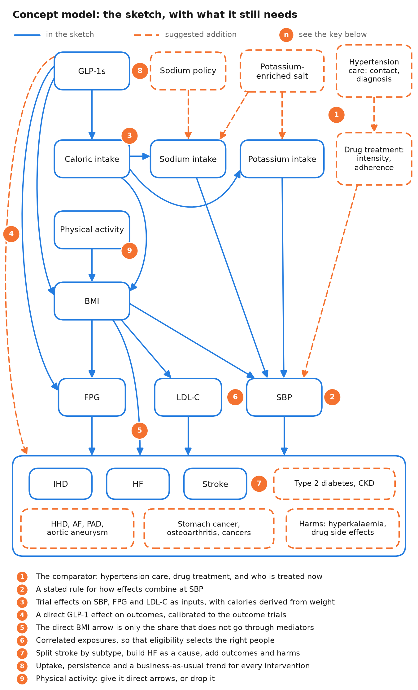

# Running notes: sodium reduction replication

Working log for the replication of Dhungel et al. (2025). Newest entries at
the bottom. The README holds the write-up; this file holds what I tried, in
order, including the dead ends.

## 2026-10-27 (cloud session, summarized)

- Built the model on the Claude cloud sandbox from GBD 2023 pulled through
  the IHME GBD MCP server. Results: HALY gains 65% to 88% of the paper's
  medians for the seven main scenarios, about half for the two small UK
  programs; mortality reductions about half to two-thirds of the paper's.
- Suspects for the shortfall, from the decomposition: the mortality pathway
  (deaths averted), not the disability pathway.
- Supplementary material was not reachable from the sandbox (ScienceDirect 403).

## 2026-10-27 (cluster session)

Session moved to the IHME cluster. New inputs available: the paper's
supplementary appendix (uploaded by Abie), `vivarium_inputs` and `gbd_mapping`
against the GBD databases, the old `ihmeuw/vivarium_sodium_reduction` repo,
and a recent private simulation project for data access patterns.

Question to answer: why are deaths averted smaller in my replication?

### Appendix, first read (mmc1.pdf, 28 pages)

- **Table S3 gives the SBP equation.** Per gram of sodium removed:
  `2.026 + 0.502 * (age - 50)/10 + 0.659 * (SBP - 140)/10 + 2.353 * p_nonwhite`,
  with p_nonwhite = 0 for Australia. My reconstruction from Huang et al. had
  0.371 per decade of age and 0.248 per 10 mmHg, so the paper's age slope is
  1.35x mine and its SBP slope 2.7x mine. At age 70 and SBP 150 the paper
  gets 3.69 mmHg per gram against my 3.0; at 80 and 160, 4.85 against 3.6.
  Deaths are concentrated exactly there, so this is a prime suspect.
- Table S5 confirms the equation is floored at zero (young, low-SBP cells
  show 0.00) and shows about 3.6 mmHg per gram at 70+ and SBP 140 to 149.
- **Sodium TMREL of 2 g/day for the SBP link**: only intake above 2 g/day
  counts, following Trieu et al. Needs checking against the sodium means
  (Table S1): if the paper's baseline intake is higher than GBD 2023's
  2.1 to 4.1 g/day, the absolute reduction (proportion x baseline) is larger
  in the paper for the same proportional cut.
- **Table S6, the 18 diseases**: IHD, ischemic stroke, ICH, SAH, hypertensive
  heart disease, atrial fibrillation, stomach cancer, non-rheumatic calcific
  aortic valve disease, other cardiomyopathy, CKD (T1 diabetes, T2 diabetes,
  hypertension, glomerulonephritis, other), rheumatic heart disease, aortic
  aneurysm, endocarditis, peripheral artery disease. Mine has 13 of these
  (no T1-diabetes CKD, calcific aortic valve, other cardiomyopathy, rheumatic
  heart disease, endocarditis, since GBD 2023 no longer attributes them to SBP).

### Baseline exposures: the paper's Tables S1 and S2 versus GBD 2023

Table S1 (Trieu et al.) gives sodium means by sex, age and SEIFA quintile;
averaging the five quintiles, men run from 4.4 g/day at 25 to 29 down to
3.1 at 80+, women from 3.2 to 2.6. GBD 2023's exposure for Australia, which
my first artifact used, is 3.6 to 2.4 for men and 2.8 to 2.2 for women. The
proportional reductions in Table 1 therefore remove 20 to 45% more sodium
in the paper than in my model, most of the gap at the ages where the deaths
are. Table S2's SBP means are close to GBD's for men but 5 to 7 mmHg lower
for women at older ages, with SDs of 12 (age 25) to 21 (age 85); my assumed
SDs were 11 to 20, so that part was fine.

Decision: switch the sodium and SBP exposure inputs to the paper's tables
(quintiles averaged with equal weight, since SEIFA quintiles are equal-size
by construction) and keep GBD for the disease rates and relative risks.
Transcribed tables are in `data/paper/`.

### Cluster resources

- `vivarium_inputs` 7.2.4 + `gbd_mapping` 5.0.4 in the
  `vivarium_csu_alzheimers_artifact` conda env, pointed at GBD 2023
  (release 16). Pulls for Australia are running in the background into
  the scratchpad; each measure takes 10 to 60 s against the database.
- GBD 2023 attributes high SBP to 12 causes (same set as GBD 2021); the
  paper's extra five are GBD 2019 (release 6) outcomes only.
- Slurm: partitions `all.q` and `long.q`, account `proj_simscience`
  (from that private project's sbatch scripts). This node has 4 CPUs.

### What the appendix inputs do to the SBP reduction (no simulation yet)

Mean SBP reduction under the WHO targets in 2030, by sex and age, old inputs
(my Huang reconstruction, GBD 2023 sodium and SBP) against the appendix
inputs (Table S3 equation with the 2 g floor, Table S1 sodium, Table S2 SBP):

| | men 45 | men 60 | men 70 | men 80+ | women 50 | women 65 | women 80+ |
|---|---|---|---|---|---|---|---|
| old, mmHg | 0.76 | 0.84 | 0.85 | 1.0 to 1.2 | 0.57 | 0.71 | 0.9 to 1.1 |
| new, mmHg | 0.39 | 1.05 | 1.36 | 1.6 to 1.9 | 0.32 | 0.75 | 1.1 to 1.4 |
| ratio | 0.5 | 1.25 | 1.6 | 1.55 | 0.55 | 1.05 | 1.25 |

Under 40 the appendix equation gives zero (the age and SBP terms pull the
slope below zero, and Table S5 shows the same zeros), so the young lose
their small effect, while men over 60 gain 25 to 60% and women over 75
about 25%. Deaths sit at those ages, so this should close a good part of
the mortality gap. The sodium baseline matters more than the equation for
men over 60: with the new equation but GBD sodium the 70+ effect is 0.9 to
1.4, with the paper's sodium 1.4 to 1.9.

### GBD 2023 relative risks from vivarium_inputs

`get_measure(high_systolic_blood_pressure, "relative_risk", "Australia")`
returns a Burden-of-Proof curve on a 1,000-point grid from 90 to 200 mmHg
for seven causes only (AF, HHD, ICH, IHD, ischemic stroke, PAD, SAH); the
four CKD causes and aortic aneurysm are absent, and HHD is all zeros since
GBD treats it as a PAF-of-one cause. The curves are close to log-linear
above the TMREL: at age 65 the slope per 10 mmHg is 1.33 for IHD, 1.38 for
the three strokes, 1.19 for AF, 1.04 for PAD. My PAF-implied log-linear RRs
were 1.30, 1.38, 1.14 and 1.05 at that age, so the first artifact's relative
risks were not the problem. Plan: fit a log-linear slope to each curve
between 115 and 175 mmHg and keep the PAF-implied values for the causes
without curves.

### Experiments queued (cluster)

1. **v2 artifact**: GBD 2023 cause data and fitted relative risks from
   vivarium_inputs, the paper's sodium and SBP distributions, the Table S3
   SBP equation. Full 10 scenarios x 3 seeds x 200k on a 16-core sbatch job
   once the pull finishes (about 20 cause-measure pulls at 10 to 60 s each
   still to go).
2. **Time-step ablation** on the first artifact: BAU and WHO targets at
   100k simulants, seed 0, annual (365.25 d) versus quarterly (91.3 d)
   steps, to measure how much the annual cycle's one-year delay of acute
   deaths costs. Running now on this node, tags `v1_annual`, `v1_quarterly`.
   The raw results from the cloud session were never committed, so the
   annual run is needed as the matching baseline.

### Log-linear or the GBD curves?

Abie pointed out that `vivarium_public_health` has `NonLogLinearRiskEffect`
for curve-form relative risks (the private project stores the GBD curve
under the standard `relative_risk` key with a numeric `parameter` column and
computes PAFs in a separate PAF-calculation spec). The paper used GBD 2019
incidence rate ratios per 10 mmHg, which are log-linear, so the log-linear
fit stays the main specification as the closer match to the published
method. The curves go into a second spec, `model_spec_nonloglinear.yaml`,
for the six SBP causes with usable curves (IHD, the three strokes, AF, PAD)
and for sodium on stomach cancer, with PAFs computed analytically from the
curve under the paper's exposure distribution (keys `*.relative_risk_curve`
and `*.population_attributable_fraction_curve`). Runs select the spec with
`--spec`; this is a sensitivity analysis, not the headline.

### The paper is GBD 2019 throughout (Abie, from Tony Blakely's group)

The group did not have time to download the updated GBD results, so every
GBD input in the paper is GBD 2019: the 18-cause list, the relative risks
per 10 mmHg (GBD 2019 appendix 2b), the PIFs, and the disease rates
forecast from 1990 to 2019 trends. My model is GBD 2023 (release 16).
Candidates this opens up: GBD 2019 relative risks were larger for some
causes than the 2023 Burden-of-Proof slopes; GBD 2023 revised Australian
CVD mortality and has the COVID years in the series; the five causes GBD
2023 no longer attributes to SBP. Pulling GBD 2019 (release 6) SBP relative
risks with `get_draws` for a direct comparison, and testing whether
`get_outputs(release_id=6)` can give the 2019 cause rates for a GBD 2019
version of the artifact.

### Time-step ablation (first artifact, 100k simulants, seed 0, BAU vs WHO targets)

| step | HALYs gained | deaths averted | ACMR change 2040-44 |
|---|---|---|---|
| annual (365.25 d) | 24,700 | 6,470 | -0.18% |
| quarterly (91.3 d) | 32,900 | 4,310 | -0.16% |

One seed only, and at 100k a single death is 270 real deaths, so the death
counts are noise; the HALY difference is mostly disability (prevalence
dynamics), which is much less noisy. The quarterly step gives a third more
HALYs. I had argued the annual step matched the paper's annual cycle, but
vivarium's discretization is not a PMSLT cycle: incidence in a year lands in
the state only at the next step, and the clipped probabilities delay acute
deaths. The quarterly step is the better vivarium choice; the production
runs on the cluster will use it (about four times the cost, affordable with
16 cores).

### GBD 2023 pull finished

115 cause-measure and risk pulls done (one benign failure: other
cardiomyopathy has no incidence in GBD 2023 and is not in the 2023 cause
set anyway). Condensing into `data/gbd_vi/` and building the v2 artifact.

### GBD 2019 versus GBD 2023 inputs for Australia (men; full table in results/gbd2019_vs_gbd2023_rates_males.csv)

| | age 55 | age 70 | age 85 |
|---|---|---|---|
| IHD deaths, 2019/2023 | 1.04 | 1.30 | 1.45 |
| IHD incidence, 2019/2023 | 4.5 | 4.1 | 2.4 |
| IHD prevalence, 2019/2023 | 1.6 | 2.6 | 2.4 |
| ischemic stroke deaths, 2019/2023 | 1.04 | 1.55 | 1.65 |
| ischemic stroke prevalence, 2019/2023 | 0.65 | 0.69 | 0.50 |
| all-cause deaths, 2019/2023 | 1.06 | 1.19 | 1.12 |

GBD 2023 cut Australian cardiovascular mortality at the ages that matter
by a third or more relative to GBD 2019, and the GBD 2019 IHD incidence is
a different quantity (it includes angina and chronic IHD, where GBD 2023
counts acute MI only). Both push the paper's deaths averted above mine.
The GBD 2019 artifact (`artifacts/australia_gbd2019.hdf`, 18 causes, GBD
2019 relative risks per 10 mmHg, paper exposures) is built; smoke test
running, then the full set on the cluster at quarterly steps.

### GBD 2019 smoke test (20k simulants, seed 0, annual steps, BAU vs WHO)

WHO targets: 46,900 HALYs gained (paper 40,100), 9,430 deaths averted,
crude mortality rate down 0.28% over 2040 to 2044 (the paper's Table 3
gives 0.29% in the most deprived quintile and 0.18% in the least). One
seed at 20k is noisy (one death is 1,350 real deaths), but the mortality
gap is gone with GBD 2019 inputs plus the appendix's SBP equation and
exposures. Baseline BAU deaths 198,000 in 2024 against GBD 2019's 2019
count of about 170,000 scaled to the 2023 population, which is the
expected shape (the 2023 population is older). Submitted the full set to
Slurm: 10 scenarios x 3 seeds x 200k, quarterly steps, tag `gbd2019`.

### GBD 2023 (v2) artifact: last data gaps

vivarium_inputs refuses aortic aneurysm nonfatal measures ("YLL only
cause"), has no HHD incidence (derived from prevalence and EMR, as in the
first artifact) and no other-cardiomyopathy incidence (not in the 2023 SBP
set anyway). The five peripheral arterial disease files were missing from
the first pull for no logged reason; re-pulling. The GBD 2019 production
set (Slurm job 64758034, 16 cores) is running.

### GBD 2023 (v2) artifact built

`artifacts/australia_v2.hdf`: 12 causes from vivarium_inputs (draw means),
HHD incidence derived, aortic aneurysm fatal-only, the paper's sodium and
SBP distributions, log-linear slopes fitted to the GBD 2023 curves for IHD,
the three strokes, AF and PAD, PAF-backed-out slopes for CKD and aortic
aneurysm (capped PAF for HHD and CKD due to hypertension), and curve-form
relative risks plus consistent PAFs for the non-log-linear sensitivity
spec. Smoke tests of both specs running (BAU and WHO, 20k, seed 0).

### Smoke tests side by side (BAU vs WHO targets, 20k simulants, seed 0, annual steps)

| inputs | HALYs gained | deaths averted | ACMR change 2040-44 | ratio to paper |
|---|---|---|---|---|
| first artifact (GBD 2023 MCP, my Huang reconstruction), 100k | 24,700 | 6,470 | -0.18% | 0.62 |
| GBD 2023 via vivarium_inputs, appendix equation and exposures | 22,400 | 5,390 | -0.29% | 0.56 |
| GBD 2019 via get_outputs, 18 causes, appendix equation and exposures | 46,900 | 9,430 | -0.28% | 1.17 |

Twenty thousand simulants is noisy (the GBD 2023 line's deaths averted
equals four simulant deaths), but the pattern is clear: the appendix's SBP
equation and exposures do not by themselves close the gap under GBD 2023,
while switching the disease rates and relative risks to GBD 2019, the
release the paper used, overshoots it. The GBD release is the dominant
driver. A bug found on the way: the slopes fitted to the GBD 2023 curves
were stored per 1 mmHg while the artifact applies them per 10 mmHg, which
made the first GBD 2023 smoke test show no effect at all; fixed before the
numbers above. Production sets for both releases are on Slurm (quarterly
steps, 200k, 3 seeds); the non-log-linear sensitivity follows.

### Caveat on the smoke tests, and the non-log-linear smoke

The non-log-linear spec's smoke test (GBD 2023 curves) gave 38,100 HALYs
against 22,400 for the log-linear fit on the same artifact, seed and
population, yet a direct calculation shows the two forms give the same
IHD incidence reduction per 1.3 mmHg (0.964 versus 0.965 at age 70). The
curves sit at RR 1.0 at 95 mmHg, 1.04 at 105, 1.25 at 115, so they add
little below the TMREL. The difference is therefore noise: at 20,000
simulants a single WHO run moved from 23,000 to 35,000 HALYs between 20k
and 200k in the cloud session. Smoke tests say whether a model runs and
roughly where it lands; the three Slurm sets (GBD 2019, GBD 2023
log-linear, GBD 2023 curves; jobs 64758034, 64763287, 64763402) are the
numbers to read.

### GBD 2019 production set, early read (seed 0 of 3, quarterly steps, 200k)

WHO targets 67,500 HALYs (paper 40,100), immediate 30% KCl 163,000
(103,000), UK program 10,700 (6,880): ratios of 1.5 to 1.7 across the
board, with the crude mortality change for the WHO targets at -0.34%
(paper -0.29% most deprived, -0.18% least). So the GBD 2019 inputs
overshoot where the GBD 2023 inputs undershoot. Two known differences
push the GBD 2019 variant up relative to the paper: the quarterly step (a
third more HALYs than annual in the ablation) and the absence of the
paper's BAU trends, which carry GBD 2019's 1990 to 2019 declines in
incidence and case fatality forward to 2034.

### BAU rate trends (fourth set)

`RateTrends` scales each cause's incidence and excess mortality, aortic
aneurysm mortality and the all-cause hazard by exp(apc x (min(year, 2034)
- 2019)), with apc the 2000 to 2019 log-linear slope of GBD 2019
age-standardised rates for Australia (`data/gbd2019/trends_apc.csv`,
capped at +/-4% a year; case fatality is deaths over prevalence). IHD
case fatality falls 3.6% a year and incidence 1%, ischemic stroke 3% and
1.8%, all-cause mortality 1.5%. By 2034 IHD excess mortality is 58% of
its 2019 level, so this should pull the GBD 2019 variant down toward the
paper. Spec `model_spec_gbd2019_trends.yaml`.

### GBD 2019 incidence is not prevalence-consistent; artifact rebuilt

Checking the DisMod identity I = (dP/da + P EMR)/(1 - P) against the
published GBD 2019 incidence: IHD's published incidence is 1.5 to 1.8 times
the consistent value (it counts angina and chronic entries), PAD's 1.3 to
1.7, while ischemic stroke and AF agree within 10%. Under an SI model the
published IHD incidence would inflate the IHD pool over 20 years and with
it every IHD death and every death the intervention averts. The GBD 2019
artifact now derives incidence from prevalence and EMR for every cause,
which is the consistency step SHINE's input processing performs. The
runs with the published incidence were stopped at 16 of 30 and kept under
tag `gbd2019_gbdinc` for the record; the GBD 2019 and GBD 2019 plus
trends sets were resubmitted. The baseline rise in deaths from about
190,000 in 2024 to 330,000 in 2044 is the same in every variant, so it is
the ageing of the 2023 population without migration, not an artefact of
one release.

`RateTrends` bug found in its smoke test: DiseaseModel components are named
`disease_model.<cause>`, so no cause-level modifier matched; fixed.

### GBD 2023 production sets, final (200k simulants, quarterly steps)

Log-linear fit to the GBD 2023 curves, 3 seeds; curve form
(NonLogLinearRiskEffect), 2 seeds. Ratio of mean HALYs gained to the
paper's median, and the crude mortality-rate change over 2040-44:

| intervention | log-linear | curves | paper 95% UI covers both? | ACMR change, log-linear / curves / paper (SEIFA 1, SEIFA 5) |
|---|---|---|---|---|
| Mandating Australia | 1.30 | 1.20 | yes | -0.03 / -0.05 / -0.08, -0.05 |
| Mandating UK | 1.17 | 1.17 | yes | -0.14 / -0.16 / -0.18, -0.11 |
| Mandating WHO | 1.18 | 1.16 | yes | -0.21 / -0.24 / -0.29, -0.18 |
| Australia then UK | 1.21 | 1.19 | yes | -0.13 / -0.16 / -0.17, -0.11 |
| 30% KCl immediate | 1.19 | 1.17 | yes | -0.44 / -0.47 / -0.66, -0.36 |
| 10% KCl over 10 y | 1.11 | 1.00 | yes | -0.13 / -0.17 / -0.19, -0.12 |
| 30% KCl discretionary | 1.44 | 1.34 | yes | -0.07 / -0.07 / -0.11, -0.07 |
| UK mass media | 1.35 | 1.58 | yes | 0.00 / 0.00 / 0.00, -0.01 |
| UK salt program | 1.05 | 1.23 | yes | 0.00 / -0.02 / -0.05, -0.03 |

Every estimate sits inside the paper's uncertainty interval and the
mortality reductions fall between the paper's two quintiles. The curve
form and the log-linear fit agree to within seed noise, as the direct
calculation said they should. Compared with the cloud session's 0.65 to
0.88, the move came from three things applied together: the appendix's SBP
equation and sodium baselines (the SBP reduction at 60+ up 25 to 60%), the
quarterly step (a third more HALYs than annual), and vivarium_inputs'
DisMod-consistent excess mortality in place of CSMR over prevalence.

### GBD 2019 production sets, final

GBD 2019 with prevalence-consistent incidence (3 seeds): 1.3 to 1.7 times
the paper's medians (mass media 1.4). With the paper's BAU trends (2 seeds):
1.07 to 1.30, mass media 2.2 (two seeds of a 1,000-HALY effect; noise).
Mortality changes for the WHO targets -0.19% and -0.22%, within the paper's
quintile range. The trends variant is the closest of the five to the paper,
which is what the paper's own method predicts.

### Where this leaves the replication

Ratios of model to paper medians, all nine interventions: cloud round 0.49
to 0.88; GBD 2023 (appendix inputs, quarterly) 1.04 to 1.44; GBD 2023 with
the RR curves 1.00 to 1.58; GBD 2019 1.34 to 1.68; GBD 2019 with trends
1.07 to 1.30 (2.2 for mass media). The paper's 95% intervals contain every
GBD 2023 estimate and all but the mass media estimate of the trends variant.
What moved the answer, in order: the Table S3 SBP equation plus the Table
S1 sodium baselines; the quarterly step; the GBD release (and, within GBD
2019, the incidence consistency fix); the BAU trends. The relative risks and
their functional form did not matter. Write-up in README.md; combined table
in results/comparison_all.csv and figure in results/halys_comparison_all.png.
Open: trends on the GBD 2023 variant, SEIFA, costs, draw-level uncertainty.
(Migration was listed here as an open item until the 2026-10-28 entry below
showed the paper's cohort is closed.)

## 2026-10-28: migration, GBD migration data, history cleanup

Asked: does migration appear in the paper, what GBD data could support it, and
how to get the 219 MB of raw results out of the branch history.

**The paper's cohort is closed.** The main paper's text is not retrievable
from the cluster (ScienceDirect refuses the fetch; no PMC copy; PMID 41093110,
doi 10.1016/j.tjnut.2025.10.009). The appendix only says "closed cohort" in the
title of Table S10 (lifetime HALYs). The paper condenses the SHINE report "The
Health and Cost Impacts of Sodium Reduction Interventions in Australia"
(Blakely, Grimshaw, Wilson, 27 October 2023, University of Melbourne figshare
29975281, 101 pages), which is explicit. Page 26, Demographics: "The baseline
population counts by sex, age and SEIFA quintile were sourced from Australian
Bureau of Statistics data for 2019. Moderate scenario fertility projections
from the Australian Bureau of Statistics were used to introduce new cohorts
born in 2019, 2020, 2021 and 2022, effectively creating a closed cohort from
2023 onwards." Page 65 lists an open cohort "(i.e. including new births, and
possible migrants)" as something SHINE "will in the future pivot to". So the
guess in the README that the paper's population grows through migration was
wrong, and the demographic difference runs the other way: GBD 2023 puts
Australia's 2023 population at 26.9 million, ABS 2019 aged forward with births
and deaths but no migration is about 25.9 million, and the missing 2019 to
2023 migrants are young (7% aged 45 and over in the forecast age pattern), so
my population is about 1% larger at the ages where the HALYs accrue. README
corrected in three places.

**What GBD can support.** Past: GBD 2023 net migration counts by sex, all
ages, 1950 to 2023 (via the GBD MCP `get_population` with
`measure="migration"`); Australia 103,000 in 2000, 343,000 in 2019 and 2020,
316,000 in 2023. The series is smoothed and does not show the 2020 to 2021
border closure (ABS net overseas migration was negative in 2020-21), so it is a
level, not a history. Future: the Future Health Scenarios GBD 2023 reference
forecast, release 32, scenario 130, version `gbd_2023_migration_s130v57`
(August 2025), at
`/mnt/share/forecasting/data/32/future/migration/gbd_2023_migration_s130v57/`:
`migration.nc` has net migrant counts by 96 single-year age groups, sex, year
2023 to 2100 and 100 draws for 484 locations (4.2 GB; the Australia slice loads
in about 20 s with xarray); `mig_counts.nc` the all-age totals;
`migration_single_years.nc` the all-age rate per 1,000 from 1990. Australia's
forecast totals: 143,000 in 2023, 203,000 in 2024, 213,000 in 2030, 228,000 in
2040. The 2025 age pattern is 23% under 15, 35% aged 15 to 24, 27% aged 25 to
34, 8% aged 35 to 44 and 7% aged 45 and over, split evenly by sex. A five-year
sample for Australia (draw mean) is in the session scratchpad, not committed,
since the forecast version is internal. `db_queries` has no migration
covariate, and `vivarium_public_health` 6.8 has no migration component.

**How much it would matter.** Person-years inside 2024 to 2043 contributed by
arrivals after 2024, against the 2023 population aged forward with no
mortality (a crude upper bound on the denominator, so these shares are
slightly low):

| Ages | Migrant person-years | Baseline person-years | Added |
|---|---|---|---|
| all | 41.9 M | 533 M | 7.9% |
| 45+ | 5.3 M | 305 M | 1.7% |
| 60+ | 1.5 M | 196 M | 0.8% |
| 70+ | 0.7 M | 130 M | 0.5% |

So an open cohort with migration would add on the order of 2% to the 20-year
HALYs, under the seed-to-seed noise, and in any case the paper excludes it.
If wanted: `BasePopulation.on_initialize_simulants` takes `age_start` and
`age_end` from `pop_data.user_data` (base_population.py lines 248 to 251), so a
component can call `simulant_creator(n, {"age_start": a, "age_end": a + 1,
"sim_state": "time_step"})` per age and step with `n` scaled by the simulant
to population ratio, and the risk and disease initializers then treat the
arrivals like the initial population. Net outflows at an age would need
untracking; the Australian forecast has none.

**History cleanup, rehearsed.** The raw results were added across ten commits
from 06e1814 to 4e7e2f8, not one, so the fix is a rewrite of the 21 branch
commits. In a scratch clone, `git filter-branch --prune-empty --index-filter
'git rm -r -q --cached --ignore-unmatch
"sodium_reduction_australia_replication/results/raw*"' -- origin/main..HEAD`
rewrote all 21 commits in about a second, left the final tree identical to the
current HEAD (`git diff --stat` empty), left no `results/raw` path in any
branch commit, and cut the branch-only blobs from 219 MB to 9 MB (6.4 MB of
condensed data extracts, 2 MB of results). `git filter-repo` is not installed
here (git 2.25.1), so the built-in command is the one path. The instructions
went to the user; nothing was rewritten in the real repo.

## 2026-11-27: what a concept model for GLP-1s, sodium and potassium needs

Asked: review a hand-drawn concept model. Say what else it needs to support the
modeling questions, and to compare them with scaling up access to hypertension
treatment.

The figure redraws the sketch in solid blue and marks suggested additions in
dashed orange. `figures/concept_model_markup.py` draws it. The numbers on the
figure match the numbered list below.

**The sketch as I read it.** GLP-1s point to caloric intake, BMI and FPG.
Caloric intake points to BMI, sodium intake and potassium intake. Physical
activity points to BMI. BMI points to FPG, SBP and LDL-C. Sodium intake and
potassium intake point to SBP. BMI, FPG, SBP and LDL-C point to one box of
outcomes that holds IHD, HF and stroke.

**The questions as I read them.** This is my reading, not something the user
wrote down. The model should give the health gain from GLP-1s, from sodium
reduction and from potassium-enriched salt, and compare each with scaling up
hypertension treatment. Sodium reduction is the replication on this branch.
Potassium-enriched salt is the replication of Huang and colleagues (2026) in
`potassium_salt_replication/` on main. That model is static, counts deaths
only, and covers 193 countries.

### What the sketch needs

1. **The comparator.** The sketch has no node for hypertension treatment. It
   needs hypertension care (contact with care, diagnosis), drug treatment
   (intensity, adherence), and an arrow from drug treatment to SBP. It also
   needs a baseline. The documentation of the public US cardiovascular model
   (`ihmeuw/vivarium_nih_us_cvd`) states that the GBD exposure for SBP includes
   the benefit of current medication. The model must therefore know who is
   treated now, by SBP, age and sex, and must add the drug effect back to get
   untreated SBP. The public US model does this. It adds 5.1% to SBP for
   adherent people on one drug and 12% for two drugs. It also has visits, measurement error (SD 2.9 mmHg), therapeutic
   inertia, six treatment levels with efficacy that depends on starting SBP,
   three adherence categories, discontinuation, and baseline coverage from a
   regression on NHANES. All of it is fitted to the United States. For other
   countries NCD-RisC gives the shares diagnosed, treated and controlled by
   sex and age. NCD-RisC does not say how treatment lines up with SBP inside
   an age group. The potassium replication met this gap. Its scenario for 80%
   of people with diagnosed hypertension averts 0.54 million deaths a year when
   status is independent of SBP, and 0.69 million when the people with the
   highest SBP are the ones with hypertension.
   "Access" must also name what moves: the contact rate, diagnosis, the start
   of treatment, intensification, or adherence.

2. **A rule for how effects combine at SBP.** Four arrows meet at SBP: BMI,
   sodium, potassium and drug treatment. None of the effects is constant. The
   appendix equation on this branch gives 2.026 + 0.0502 (age - 50) + 0.0659
   (SBP - 140) mmHg per gram of sodium. The potassium replication adds 1.874
   mmHg per 100 mmol of sodium for people with hypertension. Its potassium
   slope depends on sodium intake. Drug efficacy depends on starting SBP. The
   order of application therefore changes the answer, and treatment status
   changes the diet effects. The model needs a stated order. Each intervention
   needs a run alone and a run in combination. The documentation of the public
   US model lists concurrent interventions as a limitation.

3. **Trial effects as inputs, with calories derived.** GLP-1 trials report the
   change in weight, SBP, glucose and lipids. Each reported change already
   includes every path in the sketch, through weight, sodium and potassium. A
   model that applies the trial change in SBP and also sends caloric intake
   through sodium and potassium to SBP counts the effect twice. My
   recommendation is a judgment: the arrows from GLP-1s to BMI, FPG, SBP and
   LDL-C take trial values, and caloric intake is derived from the weight
   change with an energy balance model. The sodium and potassium changes then
   serve three purposes. They carry the stomach cancer effect of sodium. They
   interact with sodium policy. They give a consistency check on the trial SBP
   value. The sketch also has a direct arrow from GLP-1s to BMI next to the
   path through caloric intake. One of the two is redundant. GBD has no
   potassium exposure and no energy intake per person. Covariate 977 is named
   "energy unadjusted(kcal)". I take it to be a national figure, and I did not
   pull it. A dietary survey with individual records is the source for both.

4. **A direct GLP-1 effect on outcomes.** According to PubMed, SELECT found a
   hazard ratio of 0.80 (0.72 to 0.90) for major cardiovascular events over a
   mean of 39.8 months
   ([Lincoff and colleagues 2023](https://doi.org/10.1056/NEJMoa2307563)). A
   prespecified analysis found no linear trend that links weight loss at week
   20 with later risk, and estimated that waist circumference reduction
   mediated 33% of the benefit
   ([Deanfield and colleagues 2025](https://doi.org/10.1016/S0140-6736(25)01375-3)).
   A model that sends the whole effect through BMI and its mediators therefore
   needs one more arrow, from GLP-1s to the outcomes, calibrated to the trial.
   SELECT enrolled people with existing cardiovascular disease. Calibration
   needs disease models with repeat events. The `SI` models on this branch
   have none.

5. **Mediation for BMI.** The sketch has BMI act directly and through FPG, SBP
   and LDL-C. GBD relative risks for BMI are total effects, so the direct
   arrow must hold only the share that does not go through the mediators. The
   table below has the GBD 2023 mediation factors. Most of the effect of BMI
   on stroke is already in the mediators. The public US model implements this
   as `MediatedRiskEffect`. A mediation factor splits a relative risk. It does
   not say how many mmHg SBP falls when BMI falls by one unit. Item 3 avoids
   the need for that slope.

6. **Correlated exposures.** Eligibility for GLP-1s depends on BMI and
   diabetes. Eligibility for drug treatment depends on SBP. The benefit
   depends on how BMI, SBP, FPG and LDL-C line up within a person. The public
   US model has `RiskCorrelation` with correlations from NHANES. Another
   country needs a survey with individual measurements. The same holds for
   diet: energy, sodium and potassium intake rise together.

7. **Outcomes that match the arrows.** Stroke needs a split by subtype. In
   GBD 2023, LDL-C has a pair with ischemic stroke only, and FPG has none with
   subarachnoid hemorrhage. HF is an impairment in GBD and has no risk pairs.
   The public US model builds HF as a cause, with a literature relative risk
   of 1.14 per unit of BMI, an effect of categorical SBP, and no effect of
   LDL-C or FPG. HF is also partly a consequence of IHD. A fair comparison
   needs the outcomes that only some interventions change: type 2 diabetes and
   CKD (GLP-1s, drug treatment, and the safety of potassium), stomach cancer
   (sodium), HHD, AF, PAD and aortic aneurysm (SBP, already on this branch),
   osteoarthritis, low back pain and cancers (BMI only). It also needs harms:
   hyperkalaemia in CKD, and adverse events of the drugs. In SELECT 16.6% of
   the semaglutide group and 8.2% of the placebo group stopped permanently for
   adverse events. The common unit should be HALYs or DALYs. The potassium
   replication counts deaths only.

8. **Uptake, persistence and a business-as-usual trend.** GLP-1s need
   eligibility, uptake, discontinuation and weight regain. According to
   PubMed, participants in the STEP 1 extension regained two thirds of their
   weight loss in the year after withdrawal, and the cardiometabolic changes
   reverted ([Wilding and colleagues 2022](https://doi.org/10.1111/dom.14725)). Drug
   treatment needs adherence and discontinuation. Each intervention needs a
   stated baseline. GBD 2023 exposures describe 2023. `RateTrends` on this
   branch moves disease rates and nothing moves exposures.

9. **Physical activity.** The node has no intervention and one arrow, to BMI.
   GBD 2023 has pairs for low physical activity with IHD, ischemic stroke,
   type 2 diabetes, PAD, CKD, and colon and breast cancer. Its mediation
   matrix sends part of that effect through FPG and none through BMI. The one
   arrow in the sketch is therefore an arrow that GBD does not have. The node
   needs direct arrows, or it can go. I would drop it unless one of the
   questions is a physical activity intervention. That is a judgment.

### What GBD 2023 supports

Risk-outcome pairs for the outcomes in the sketch, from the GBD 2023 cause-risk
hierarchy:

| Risk | IHD | Ischemic stroke | Intracerebral hemorrhage | Subarachnoid hemorrhage | HF |
|---|---|---|---|---|---|
| High SBP | yes | yes | yes | yes | no pair |
| High LDL-C | yes | yes | no | no | no pair |
| High FPG | yes | yes | yes | no | no pair |
| High BMI | yes | yes | yes | yes | no pair |
| Low physical activity | yes | yes | no | no | no pair |
| Diet high in sodium | through SBP | through SBP | through SBP | through SBP | no pair |

Mean mediation factors for BMI in adults (rei 370), from
`ihme_cc_risk_utils.get_risk_mediation_matrix(rei_id=370, release_id=16)`:

| Outcome | through SBP | through FPG | through LDL-C |
|---|---|---|---|
| IHD | 0.31 | 0.15 | 0.10 |
| Ischemic stroke | 0.65 | 0.22 | 0.03 |
| Intracerebral hemorrhage | 0.65 | 0.22 | none |
| Subarachnoid hemorrhage | 0.65 | none | none |
| Atrial fibrillation | 0.31 | none | none |
| CKD | 0.50 | 0.50 | none |
| HHD | 1.00 | none | none |
| Type 2 diabetes, PAD | none | 1.00 | none |

The same call for low physical activity (rei 125) returns FPG as the only
mediator: 0.14 for IHD, 0.08 for ischemic stroke, and 1.00 for type 2 diabetes,
CKD and PAD. For diet high in sodium (rei 124) the factor through SBP is 1.00
for every cardiovascular and kidney outcome, which agrees with the sketch.

GBD has exposures for SBP, LDL-C, FPG, BMI, sodium and physical activity. It
has no potassium risk, no energy intake per person, no risk pairs for HF, and
no covariate for hypertension treatment coverage. I searched the covariate
names for treatment, hypertension and drug terms and found none. The GBD risk
table also lists entities whose names suggest internal scenario work on some
of these interventions. I reported them to the user and do not record them
here.

### The sodium and potassium paths roughly cancel

This is rough arithmetic with the slopes that the two replications already
hold.

| Nutrient | Slope, mmHg per gram | Source in the repository |
|---|---|---|
| Sodium, age 50, no hypertension | 1.6 | Mozaffarian and colleagues, in the potassium replication |
| Sodium, age 65, hypertension | 3.1 | same |
| Sodium, age 65, SBP 140 | 2.8 | appendix Table S3, this branch |
| Potassium, sodium below 3 g/day | 1.8 | Filippini and colleagues (2020), in the potassium replication |
| Potassium, sodium at or above 3 g/day | 2.8 | same |

If nutrient density stays constant, a cut of a fraction f in energy lowers
sodium by f times sodium intake and potassium by f times potassium intake. The
fall in sodium lowers SBP and the fall in potassium raises it. Mean sodium
intake in the appendix is 3.4 g/day. I did not look up potassium intake for
Australia. If the two intakes are similar in grams, the two effects are similar
in size and the net effect on SBP is near zero. The sign depends on age and
hypertension. The potassium slope comes from supplementation trials, so its
use for a fall in intake is an extrapolation.

### Published comparisons that a replication could start from

According to PubMed:

- [Kontis and colleagues 2019](https://doi.org/10.1161/CIRCULATIONAHA.118.038160)
  compare treatment of high blood pressure at 70% coverage, a 30% reduction in
  sodium, and elimination of trans fat. Treatment delays 39.4 million deaths in
  25 years and sodium reduction delays 40.0 million. Both act through blood
  pressure in a generalized population attributable fraction.
- [Pickersgill and colleagues 2022](https://doi.org/10.1038/s41591-022-01890-4) model
  the 80-80-80 targets for hypertension by country and report 76 to 130 million
  deaths averted from 2022 to 2050.
- [Pandey and colleagues 2024](https://doi.org/10.1073/pnas.2412872121) estimate that
  expanded access to weight-loss drugs in the United States averts more than
  42,000 deaths a year. The model uses mortality hazard ratios by BMI
  category. As I read the abstract, it has no direct drug effect.

### What exists already

| Need | Where | Limit |
|---|---|---|
| Sodium to SBP to twelve causes, HALYs, quarterly steps | this branch | Australia, `SI` disease models |
| Sodium and potassium dose-response, hypertension care status, hyperkalaemia in CKD | `potassium_salt_replication/` on main | static, deaths only |
| Visits, treatment levels, adherence, untreated SBP, correlation, mediation, HF as a cause | `ihmeuw/vivarium_nih_us_cvd` | United States only |
| GLP-1 component, energy intake, a rule for combining effects at SBP, costs | nowhere yet | |

Sodium reduction, potassium-enriched salt and drug treatment all act through
SBP alone. The comparison among those three needs one new component on this
branch, for drug treatment. GLP-1s need the rest: BMI, FPG and LDL-C exposures
with correlation and mediation, type 2 diabetes, and HF. This is a judgment
about the order of work.

### Not settled

- The location. The United States has NHANES for every input and the public US
  model. Australia has the sodium inputs on this branch and needs the treatment
  baseline and a dietary survey.
- What the physical activity node is for.
- What "access" moves in hypertension care.

One check did not finish. I started a pull of the GBD 2023 relative risks for
BMI in adults for Australia through `vivarium_inputs`, to see that they arrive
in a usable form. The pull reached 28 GB of memory in 12 minutes inside a job
with a 64 GB limit, and I stopped it. The check needs a job with more memory.
