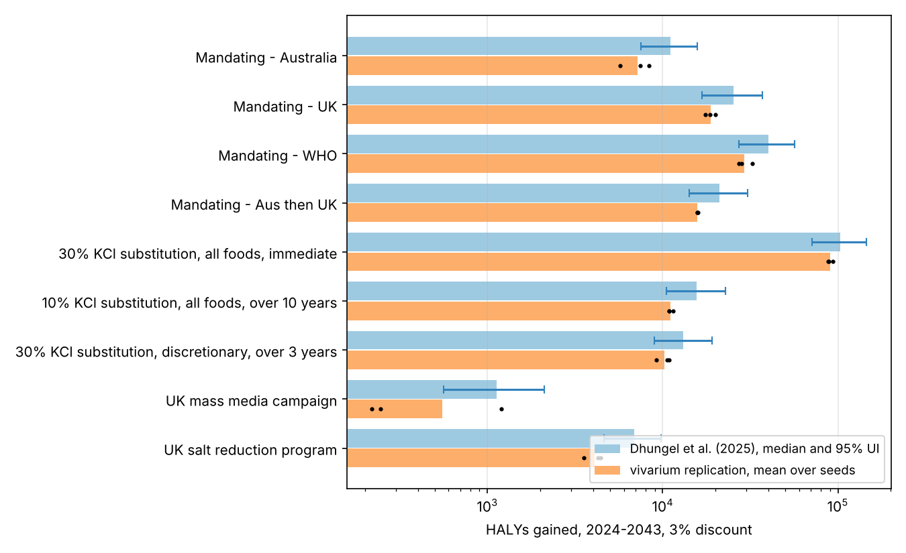

# Sodium reduction in Australia: a vivarium replication of Dhungel et al. (2025)

*Replication note. The question was whether the health gains in Dhungel et al.,
"The Health and Cost Impacts of Interventions Designed to Reduce Dietary Sodium
Intake in Australia: A Modeling Study," J Nutr 155 (2025) 4486–4501,
[doi:10.1016/j.tjnut.2025.10.009](https://doi.org/10.1016/j.tjnut.2025.10.009),
can be reproduced with IHME's
[vivarium](https://github.com/ihmeuw/vivarium-suite) microsimulation framework
and GBD 2023 inputs, using only what is in the published paper. Short answer:
the ranking and the order of magnitude replicate, the absolute HALY gains come
out RESULTS_RATIO of the paper's, and the mortality effect replicates closely.
The costs, the socioeconomic inequality results, and the uncertainty intervals I
did not attempt.*



## Headline

RESULTS_TABLE

## What the paper does

Dhungel et al. run a proportional multistate lifetable (PMSLT) for the
Australian population of 25.3 million over 20 years, 2024 to 2043, with annual
cycles. Nine interventions lower dietary sodium by a proportion that depends on
age, sex, and year (Table 1 of the paper). The sodium reduction becomes a
systolic blood pressure (SBP) reduction through a meta-regression of 48 trials
from Huang et al. (BMJ 2020), with larger effects at older ages and higher
starting SBP. The SBP change then shifts the incidence of 18 SBP-related
diseases through GBD 2019 relative risks, with sodium acting directly on stomach
cancer. The outputs are health-adjusted life years (HALYs) gained at a 3%
discount rate, all-cause mortality by socioeconomic quintile, and costs from
three perspectives. The supplementary material with the fitted SBP equation,
the disease list, and the lifetable inputs was not available to me, so
everything below is reconstructed from the main text.

## What I built

The model lives in `src/sodium_sim/` and leans on `vivarium.public_health` for
everything generic. Each simulant has an age, sex, a sodium intake, and an SBP
drawn from normal distributions whose means come from GBD 2023 exposure
estimates, and progresses through twelve susceptible-infected disease models
(the GBD 2023 outcomes of high SBP, which are fewer than GBD 2019's, plus
stomach cancer), with an all-cause mortality model that deletes the modeled
causes and adds back each disease's excess mortality. The components from the
framework are `BasePopulation`, `FertilityCrudeBirthRate`, `Mortality`, `SI`
disease models, `Risk` exposures, `RiskEffect` log-linear risk effects,
`DisabilityObserver`, and `MortalityObserver`. Three components are mine
([`components.py`](src/sodium_sim/components.py)): one scales the sodium exposure
pipeline by the scenario's schedule, one lowers the SBP exposure pipeline by the
sodium removed times the age- and SBP-specific slope, and one observes
person-time so HALYs can be assembled afterwards. Aortic aneurysm has no
nonfatal estimates in GBD 2023, so it enters through the mortality component's
"unmodeled causes" pipeline, which the SBP risk effect modifies directly.

Four reconstructions deserve a note, because each is a place where my model
and the paper's can differ.

1. **The sodium-to-SBP equation.** The paper reports one calibration point, a
   2.026 mmHg reduction per gram of sodium for a 50-year-old white person with
   SBP 140, and says the slope varies with age and starting SBP. I took the
   age and SBP slopes from the published multivariable meta-regression of Huang
   et al. (0.111 mmHg per year of age and 0.074 per mmHg, at their mean sodium
   reduction of 130 mmol/day) and rescaled them per gram
   ([`sbp_link.py`](src/sodium_sim/sbp_link.py)). A 70-year-old with SBP 150 gets
   about 3.0 mmHg per gram and a 30-year-old with SBP 120 about 0.8, which
   matches the paper's description of "very little impact on younger people and
   those with lower initial SBP," but the exact coefficients are the authors'.
2. **Relative risks per 10 mmHg.** GBD's SBP relative risks are not in the
   supplementary tables I can reach, so I backed them out of the GBD 2023
   population attributable fractions for Australia, by age and sex: the
   log-linear RR per 10 mmHg above a TMREL of 112.5 mmHg is the one whose
   population average over the assumed SBP distribution reproduces the GBD PAF
   ([`build_artifact.py`](src/sodium_sim/build_artifact.py), `solve_rr_from_paf`).
   This gives 1.35 per 10 mmHg for ischemic heart disease at age 40 falling to
   1.25 at 90, and 1.7 falling to 1.25 for the strokes, which is the familiar
   GBD age pattern. Hypertensive heart disease and CKD due to hypertension have
   PAFs of 100% by definition; I capped the PAF at 90%, which implies relative
   risks of 2 to 4 per 10 mmHg, and this cap is a choice the reader should know
   about. Within-age SBP standard deviations are assumed (11 mmHg at 25 rising
   to 20 at 75+) because the GBD extract carries only the mean.
3. **Time lags.** The paper applies the mean population impact fraction over the
   last 3 years for cardiovascular disease and over the last 2 to 20 years for
   stomach cancer. I apply the same moving averages to the proportional sodium
   reduction, which is equivalent to first order.
4. **Hypertensive heart disease incidence.** GBD 2023 publishes no incidence for
   it, so I derived one from the prevalence age gradient and the excess
   mortality, the DisMod identity `I = (dP/da + P·EMR) / (1 − P)`. Checked
   against the causes that do have incidence, this derivation lands within
   0.8 to 1.2 of GBD's figure at ages 55 and over for most of them.

The disability weight of each disease is its GBD YLD rate divided by its
prevalence, and the disability of everything not modeled is the all-cause YLD
rate minus the modeled causes', applied as a background weight in
post-processing. HALYs are person-years times one minus total disability,
discounted at 3% to 2024, and the gain is the difference from business as usual
under the same random seed, which vivarium's common random numbers make far less
noisy than the raw death counts would suggest.

## What replicates and what does not

RESULTS_DISCUSSION

## What I did not attempt

The paper's inequality results (Table 3) need the SEIFA disaggregation of every
input, which SHINE's heterogeneity module does and I have no data for. The costs
need the AIHW disease expenditure by phase, New Zealand income loss estimates,
and the Grattan intervention costings, none of which are in the main text at a
usable level of detail. The 95% uncertainty intervals in the paper come from
2,000 draws over every input; what I report is the spread over three random
seeds, which is Monte Carlo noise only and should not be read as an uncertainty
interval. Migration and the trends in disease rates after 2023 are also left
out: the simulated population only ages, is born, and dies.

## Quickstart

```bash
cd sodium_reduction_australia_replication
uv venv -p 3.12 && uv pip install -e ".[dev]"
.venv/bin/python -m sodium_sim.build_artifact       # data/gbd/*.csv -> artifacts/australia.hdf
./run_all.sh 200000 0 1 2                            # 10 scenarios x 3 seeds, 4 in parallel, ~90 minutes
```

The last command ends by writing `results/comparison.csv`,
`results/gains_by_seed.csv` and `results/halys_comparison.png`. A single scenario
runs with `python -m sodium_sim.run --scenarios mandate_who --seeds 0 --population 20000`
in about four minutes. Tests: `.venv/bin/python -m pytest`.

## Files

- `data/gbd/` GBD 2023 extracts for Australia pulled through the IHME GBD MCP
  server (population, live births, all-cause deaths and YLDs, and for each
  cause its incidence, prevalence, deaths, YLDs, and SBP or sodium PAF).
- `src/sodium_sim/build_artifact.py` turns those into a vivarium artifact and
  writes the risk-effect diagnostics to `results/risk_effect_diagnostics_*.csv`.
- `src/sodium_sim/scenarios.py` the nine intervention schedules from Table 1,
  and the paper's Figure 1 numbers for comparison.
- `src/sodium_sim/components.py`, `sbp_link.py` the model-specific components.
- `src/sodium_sim/model_spec.yaml` the vivarium model specification.
- `src/sodium_sim/run.py`, `analyze.py`, `plot.py` run, summarize, draw.

## Open directions

The largest open item is the SBP equation; with the authors' Supplemental
Table 3 the two reconstructions could be swapped for the real coefficients in
an afternoon. Costs are a bigger lift but a well-trodden one, since vivarium
models routinely carry per-state expenditure. The inequality analysis is the
hardest to reproduce without IHME-internal data. The annual time step also
deserves a check: it matches the paper's lifetable cycle, but a quarterly step
would let acute, highly fatal conditions such as subarachnoid hemorrhage kill
within the year of onset instead of the year after, and I have not measured how
much that moves the answer.
