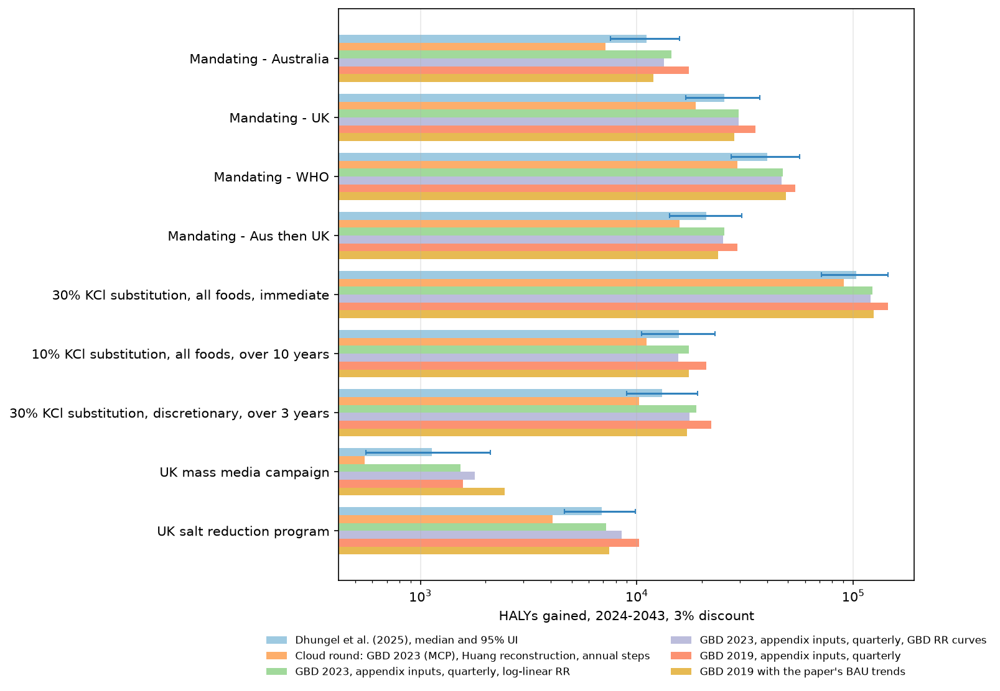

# Sodium reduction in Australia: a vivarium replication of Dhungel et al. (2025)

*Replication note. The question was whether the health gains in Dhungel et al.,
"The Health and Cost Impacts of Interventions Designed to Reduce Dietary Sodium
Intake in Australia: A Modeling Study," J Nutr 155 (2025) 4486–4501,
[doi:10.1016/j.tjnut.2025.10.009](https://doi.org/10.1016/j.tjnut.2025.10.009),
can be reproduced with IHME's
[vivarium](https://github.com/ihmeuw/vivarium-suite) microsimulation framework
and GBD inputs. Short answer: yes, to within the factor the choice of inputs
moves the answer by. With GBD 2023 inputs, the
appendix's blood-pressure equation and exposure distributions, and quarterly
time steps, every one of the nine interventions lands inside the paper's 95%
uncertainty interval, 1.0 to 1.4 times the median; with GBD 2019 inputs, the
release the paper used, and its business-as-usual trends, eight of the nine
do the same at 1.1 to 1.3 (the ninth, a mass media campaign worth about
1,000 HALYs, is seed noise). The first round of this replication, built in a cloud sandbox from
the main text alone, came out at 0.65 to 0.88, and the gap was three things
at once: my reconstruction of the sodium-to-SBP equation, a lower baseline
sodium intake, and an annual time step. The costs, the socioeconomic
inequality results, and the paper's uncertainty intervals I did not attempt.*



## Headline

HALYs gained over 2024 to 2043 at a 3% discount rate, Australia's population.
Each model column is the mean over random seeds of 200,000 simulants, with its
ratio to the paper's median in parentheses; the paper column is the median and
95% uncertainty interval of Figure 1 in Dhungel et al. The cloud round is the
first artifact (annual steps, three seeds); the four cluster variants use
quarterly steps, the appendix's inputs, and three seeds (two for the curve and
trend variants). Full tables with seed standard deviations and deaths averted
are in `results/comparison_<tag>.csv`.

| Intervention | Paper, median (95% UI) | Cloud round | GBD 2023 | GBD 2023, RR curves | GBD 2019 | GBD 2019 + trends |
|---|---|---|---|---|---|---|
| Mandating Australia's targets | 11,100 (7,530 to 15,800) | 7,170 (0.65) | 14,410 (1.30) | 13,350 (1.20) | 17,350 (1.56) | 11,900 (1.07) |
| Mandating UK targets | 25,300 (16,800 to 37,100) | 18,730 (0.74) | 29,610 (1.17) | 29,550 (1.17) | 35,260 (1.39) | 28,170 (1.11) |
| Mandating WHO targets | 40,100 (27,200 to 56,700) | 29,240 (0.73) | 47,170 (1.18) | 46,600 (1.16) | 54,100 (1.35) | 48,760 (1.22) |
| Australia then UK | 21,000 (14,200 to 30,500) | 15,800 (0.75) | 25,370 (1.21) | 25,010 (1.19) | 29,100 (1.39) | 23,680 (1.13) |
| 30% KCl, all foods, immediate | 103,000 (71,100 to 145,000) | 90,130 (0.88) | 122,290 (1.19) | 120,150 (1.17) | 144,290 (1.40) | 124,070 (1.20) |
| 10% KCl, all foods, 10 years | 15,600 (10,500 to 22,900) | 11,070 (0.71) | 17,380 (1.11) | 15,550 (1.00) | 20,910 (1.34) | 17,350 (1.11) |
| 30% KCl, discretionary, 3 years | 13,100 (8,970 to 19,100) | 10,210 (0.78) | 18,870 (1.44) | 17,550 (1.34) | 22,060 (1.68) | 17,060 (1.30) |
| UK mass media campaign | 1,130 (560 to 2,100) | 550 (0.49) | 1,530 (1.35) | 1,780 (1.58) | 1,580 (1.40) | 2,460 (2.17) |
| UK salt reduction program | 6,880 (4,640 to 9,820) | 4,080 (0.59) | 7,190 (1.04) | 8,490 (1.23) | 10,220 (1.49) | 7,470 (1.09) |

The paper's Table 3 reports the age-standardised all-cause mortality rate in
2044 by socioeconomic quintile; my crude rate over 2040 to 2044 is the nearest
thing I can compute, and it falls between the paper's most and least deprived
quintiles for the larger interventions in every cluster variant. For the WHO
targets: paper 0.29% and 0.18%, GBD 2023 0.21% (curves 0.24%), GBD 2019 0.19%
(with trends 0.22%). For immediate 30% substitution: paper 0.66% and 0.36%,
GBD 2023 0.44% (curves 0.47%), GBD 2019 0.39% (with trends 0.35%). For the
four small programs the change is within seed noise of zero, in the paper as
in the model.

## What the paper does

Dhungel et al. run a proportional multistate lifetable (PMSLT) for the
Australian population of 25.3 million over 20 years, 2024 to 2043, with annual
cycles. Nine interventions lower dietary sodium by a proportion that depends on
age, sex and year (Table 1 of the paper). The sodium reduction becomes a
systolic blood pressure (SBP) reduction through a meta-regression of 48 trials
from Huang et al. (BMJ 2020), refit by the authors as an interaction model
(appendix Table S3), with larger effects at older ages and higher starting SBP
and a floor of 2 g/day of sodium below which nothing happens. The SBP change
then shifts the incidence of 18 sodium-related diseases through GBD 2019
relative risks per 10 mmHg, with sodium acting directly on stomach cancer. The
outputs are health-adjusted life years (HALYs) gained at a 3% discount rate,
all-cause mortality by socioeconomic quintile, and costs from three
perspectives. Everything in the paper is GBD 2019; the group did not have time
to move to a newer release.

## What I built

The model lives in `src/sodium_sim/` and leans on `vivarium.public_health` for
everything generic: `BasePopulation`, `FertilityCrudeBirthRate`, `Mortality`,
`SI` disease models, continuous `Risk` exposures for sodium and SBP, log-linear
`RiskEffect`s (and, in one variant, `NonLogLinearRiskEffect` with GBD's
relative-risk curves), and the disability and mortality observers. Three
components are mine ([`components.py`](src/sodium_sim/components.py)): one
scales the sodium exposure pipeline by the scenario's schedule with the paper's
lags, one lowers the SBP exposure pipeline by the Table S3 equation applied to
the sodium removed above the 2 g/day floor
([`sbp_link.py`](src/sodium_sim/sbp_link.py)), and one observes person-time so
HALYs can be assembled afterwards. A fourth, `RateTrends`, reproduces the
paper's business-as-usual forecast by trending each cause's incidence and case
fatality and the all-cause hazard from 2019 to 2034. Aortic aneurysm has no
nonfatal estimates in either GBD release, so it enters through the mortality
component's unmodeled-causes pipeline, which the SBP effect modifies directly.
HALYs are person-years times one minus total disability (modeled causes from
the simulation plus GBD's all-cause background), discounted at 3% to 2024, and
a gain is the difference from business as usual under the same random seed.

The sodium and SBP exposure distributions are the paper's own (appendix Tables
S1 and S2, SEIFA quintiles averaged, lognormal for sodium and normal for SBP),
transcribed into `data/paper/`. Everything else comes from GBD, in two
versions:

- **GBD 2023** through `vivarium_inputs` on the IHME cluster: incidence,
  prevalence, excess mortality and disability weights for the 12 causes GBD
  2023 attributes to high SBP, plus stomach cancer; relative risks as
  log-linear slopes fitted to the GBD 2023 Burden-of-Proof curves between 115
  and 175 mmHg (one RR per 10 mmHg, the form the paper used), and the curves
  themselves for the non-log-linear variant. The four CKD causes, aortic
  aneurysm and the two PAF-of-one causes (hypertensive heart disease, CKD due
  to hypertension) have no curve, so their slopes are backed out of GBD's PAFs
  under the paper's SBP distribution, with the PAF capped at 90%.
- **GBD 2019** (release 6) through `get_outputs` and `get_draws`: rates for
  all 18 of the paper's causes and the GBD 2019 relative risks per 10 mmHg,
  which exist for every cause. GBD 2019's published incidence is not
  consistent with its prevalence and excess mortality under an SI model (for
  ischemic heart disease it is 1.5 to 1.8 times the consistent value, because
  it counts angina and chronic entries), so incidence is derived from the
  prevalence age pattern and EMR by the DisMod identity, the consistency step
  SHINE applies to its inputs.

Population attributable fractions are recomputed from each variant's relative
risks and the paper's exposure distributions, so every variant is internally
consistent. The production runs use 200,000 simulants, quarterly time steps,
and three random seeds (two for the sensitivity variants), on a 16-core Slurm
node; `NOTES.md` is the running log of what was tried, including the dead ends.

## What moved the answer

I will take the differences between the cloud round and the final variants
in the order of their size, which is also roughly the order in which I found
them. The running notes in `NOTES.md` have the numbers behind each step.

**The sodium-to-SBP link and the baseline sodium.** The supplementary appendix,
which the sandbox could not reach, gives the fitted equation (Table S3): per
gram of sodium removed, SBP falls by 2.026 mmHg at the reference person and by
0.502 mmHg more per decade of age and 0.659 per 10 mmHg of starting SBP, with
nothing below 2 g/day of intake. My reconstruction from the published Huang
multivariable regression had those slopes at 0.371 and 0.248, which is 1.35
and 2.7 times too small. The appendix also gives the baseline sodium intake
(Table S1, from Trieu et al.): 3.1 to 4.8 g/day for men and 2.2 to 3.5 for
women, 20 to 45% above the GBD 2023 exposure I had used, and the absolute cut
scales with it. Put together, the SBP reduction from the WHO targets at ages
60 and over rises by 25 to 60% for men and about 25% for women, while under
40 it drops to zero (the appendix's own Table S5 shows the same zeros). Deaths
sit at the older ages, so this is where most of the mortality gap came from.

**The time step.** The paper's lifetable has annual cycles and I had matched
it, but vivarium's discretisation is not a PMSLT cycle: a case incident during
a step enters the diseased state only at the next one, and a hazard above 1
per step is clipped to a probability of 1, which delays deaths from acute
conditions by a year. Quarterly steps give a third more HALYs than annual
ones on the same artifact and seed (32,900 against 24,700 for the WHO targets
at 100,000 simulants). The production runs use quarterly steps; it costs four
times the compute, which the cluster absorbs.

**The GBD release.** The paper is GBD 2019 throughout, because the group did
not have time to move to a newer release, and GBD 2023 revised Australia's
cardiovascular mortality down hard: ischemic heart disease deaths at ages 70
and 85 are 30 to 45% lower than in GBD 2019, ischemic stroke deaths 35 to 40%
lower, all-cause deaths 12 to 19% lower
(`results/gbd2019_vs_gbd2023_rates_males.csv`). GBD 2019's ischemic heart
disease incidence is also a different quantity, 2.4 to 4.5 times the GBD 2023
figure because it counts angina and chronic entries where GBD 2023 counts
acute myocardial infarction. That published incidence is not consistent with
GBD 2019's own prevalence and excess mortality under an SI model (1.5 to 1.8
times the value the DisMod identity implies), and running with it inflated
the IHD pool over 20 years and gave 1.5 to 1.7 times the paper; the GBD 2019
variant in the table derives incidence from prevalence and EMR instead, as
SHINE's input processing does, and comes out at 1.3 to 1.7. The GBD 2019 set
also carries the five extra causes the paper has (rheumatic heart disease,
endocarditis, calcific aortic valve disease, other cardiomyopathy, CKD due to
type 1 diabetes), which GBD 2023 no longer attributes to SBP; they are small.

**The relative risks were never the problem.** GBD 2019's published RR per 10
mmHg for ischemic heart disease at age 65 is 1.36 and for the strokes 1.36 to
1.38; the slopes fitted to the GBD 2023 Burden-of-Proof curves are 1.32 and
1.39; the values I had backed out of GBD 2023's PAFs in the cloud round were
1.30 and 1.38. Running the GBD 2023 curves as they are through
`NonLogLinearRiskEffect`, which Abie suggested, gives the same answer as the
log-linear fit to within seed noise, and a direct calculation shows why: the
two forms give the same incidence reduction per 1.3 mmHg (0.964 against 0.965
at age 70), since the curves add almost nothing below the TMREL (RR 1.04 at
105 mmHg) and are close to log-linear above it. I kept the log-linear fit as
the headline because it is the form the paper used.

**The paper's business-as-usual trends.** SHINE forecasts incidence, case
fatality and all-cause mortality from the 1990 to 2019 trends to 2034, then
holds them. GBD 2019's age-standardised Australian series give ischemic heart
disease case fatality falling 3.6% a year and incidence 1%, ischemic stroke 3%
and 1.8%, all-cause mortality 1.5% (`data/gbd2019/trends_apc.csv`, capped at
4% a year). Applying them pulls the GBD 2019 variant from 1.3 to 1.7 down to
1.1 to 1.3, the closest of the five. The mass media campaign's 2.2 is two
seeds of a 1,000-HALY effect and should be read as noise. I did not apply the
trends to the GBD 2023 variant, whose 2023 rates already embody most of that
decline, and whose match to the paper is partly that coincidence: GBD 2023's
lower rates and the paper's trended-down GBD 2019 rates arrive at similar
places over the 2024 to 2043 window.

**What I take from this.** The paper replicates: its ranking of the nine
interventions, their order of magnitude, and their mortality effects all come
out of an independent model built from GBD data and the appendix's
parameters, and the HALY totals sit inside its uncertainty intervals. The
model is also sensitive, at the level of a factor of two, to choices that a
reader of the main text would not guess at: the exact SBP equation, the
baseline intake, the time step, and which GBD release the rates come from.
Those are, in the end, the things worth putting in a supplement, and the
authors did. One thing the appendix does not settle is how far above the
paper a correct model should sit: every cluster variant exceeds the paper's
median, by 10 to 40% for the GBD 2023 and trend variants and by 35 to 70%
for GBD 2019 without trends, and the decomposition says the
excess is spread across life-years and disability rather than concentrated in
one (for the WHO targets under GBD 2023, 40,100 discounted life-years gained,
12,900 lost to background disability, 20,000 gained from less modeled
disability). I had guessed that the paper's population was growing through
migration while mine ages in place, but the SHINE report behind the paper
(Blakely, Grimshaw and Wilson, October 2023, page 26) says the opposite: the
baseline counts are ABS 2019 by sex, age and SEIFA quintile, ABS fertility
projections add the cohorts born in 2019 to 2022, and the cohort is closed from
2023 onwards, with an open cohort "including new births, and possible
migrants" named as future work (page 65). So demography pushes the other way,
and only slightly: my starting population is GBD 2023's estimate for 2023,
about 4% larger than ABS 2019 aged forward without migration, and the
difference sits at young ages, so it is worth about 1% of the HALYs. What
remains untested is the PMSLT's handling of the first year of each case.

## What I did not attempt

The paper's inequality results (Table 3) need the SEIFA disaggregation of every
input, which SHINE's heterogeneity module does and I have no data for. The costs
need the AIHW disease expenditure by phase, New Zealand income-loss estimates and
the Grattan intervention costings. The 95% uncertainty intervals in the paper
come from 2,000 draws over every input; what I report is the spread over random
seeds, which is Monte Carlo noise only. Migration is left out of both models:
the paper's cohort is closed from 2023, and my simulated population only ages,
is born and dies, which is why baseline deaths rise from about 190,000 in 2024
to 330,000 in 2044 in every variant.

## Quickstart

On the IHME cluster, from this directory:

```bash
uv venv -p 3.12 && uv pip install -e ".[dev]"
.venv/bin/python -m sodium_sim.build_artifact_v2 --source gbd2023     # artifacts/australia_v2.hdf
.venv/bin/python -m sodium_sim.build_artifact_v2 --source gbd2019     # artifacts/australia_gbd2019.hdf
sbatch sbatch/run_all.sbatch 200000 gbd2023 artifacts/australia_v2.hdf src/sodium_sim/model_spec.yaml 91.3125 0 1 2
```

The job runs the ten scenarios for each seed, 16 at a time, in about 80
minutes, then writes `results/comparison_gbd2023.csv`,
`results/gains_by_seed_gbd2023.csv` and `results/halys_comparison_gbd2023.png`.
The other variants use the specs and artifact named in `NOTES.md`; a single
scenario runs locally with `python -m sodium_sim.run --scenarios mandate_who
--seeds 0 --population 20000 --artifact artifacts/australia_v2.hdf`. The
condensed GBD extracts are committed under `data/gbd_vi/` and `data/gbd2019/`,
so the artifacts rebuild without database access; refreshing them needs the
`vivarium_csu_alzheimers_artifact` conda environment (`vivarium_inputs` 7.2,
`gbd_mapping` 5.0) and the scripts described in `NOTES.md`. Tests:
`.venv/bin/python -m pytest`.

## Files

- `NOTES.md` running notes, newest at the bottom.
- `data/paper/` appendix Tables S1 to S4, transcribed.
- `data/gbd_vi/` GBD 2023 extracts via `vivarium_inputs`, condensed to draw
  means; `data/gbd2019/` GBD 2019 extracts via `get_outputs`, relative risks
  and the 2000 to 2019 trends; `data/gbd/` the first-round extracts from the
  IHME GBD MCP server.
- `src/sodium_sim/build_artifact_v2.py` builds either artifact;
  `build_artifact.py` is the first-round builder; `prepare_gbd_vi.py` condenses
  the raw pulls and fits the curve slopes.
- `src/sodium_sim/model_spec*.yaml` the four model specifications (GBD 2023
  log-linear, GBD 2023 curves, GBD 2019, GBD 2019 with trends).
- `src/sodium_sim/scenarios.py` the nine intervention schedules from Table 1
  and the paper's Figure 1 numbers.
- `src/sodium_sim/run.py`, `analyze.py`, `plot.py`, `compare_tags.py` run,
  summarize, draw.
- `results/comparison_<tag>.csv`, `results/gains_by_seed_<tag>.csv` per
  variant; `results/comparison_all.csv` and `halys_comparison_all.png` across
  variants; `results/risk_effect_diagnostics_*.csv` the relative risks and
  PAFs that went into each artifact; `results/gbd2019_vs_gbd2023_rates_males.csv`.

## Open directions

The largest open item is the 10 to 40% by which every cluster variant exceeds
the paper. Running the GBD 2023 variant with the trends component is an
afternoon's work and would say how much of the excess the BAU trends explain
under the release the paper did not use. Migration is not needed for the
replication, since the paper's cohort is closed, but an open-cohort version is
cheap: `BasePopulation` reads `age_start` and `age_end` from the simulant
creator's user data, so a component can add arrivals at their own ages each
step, and the GBD 2023 forecasts on the cluster give net migrants by single
year of age, sex and year to 2100 with draws. I estimate it would add about 2%
to the 20-year HALYs, because arrivals after 2024 contribute under 2% of the
person-time at ages 45 and over inside the window (NOTES.md, 2026-10-28). The
inequality analysis would need SEIFA-stratified inputs, which the appendix
gives for sodium and SBP (Tables S1 and S2) but not for disease rates; a
version with quintile-specific exposures and GBD rates scaled by the
published SEIFA relative risks is worthy of attention. Costs are a bigger
lift but a well-trodden one, since vivarium models routinely carry per-state
expenditure. Proper uncertainty intervals mean running the 250 GBD draws,
which the condensed extracts under `data/` do not keep; the raw pulls do, and
the artifact builder would need a draw argument. Finally, the lesson about
time steps deserves a note in the vivarium documentation: an annual step is
not an annual lifetable cycle, and the difference here was a third of the
answer.
