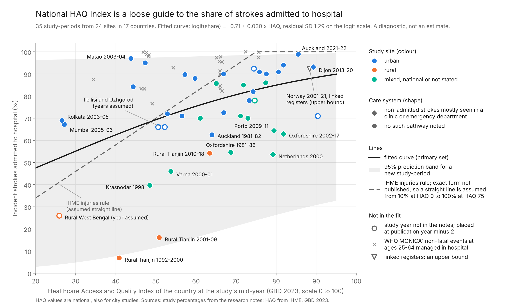

# What fraction of strokes reach a hospital?

A group of stroke researchers wants to estimate how much health the world would gain from scaling up stroke units. The calculation multiplies GBD forecasts of incident strokes by the effect of organised stroke care from a Cochrane review, and I argued for two more factors: the fraction of incident strokes that are admitted to hospital at all, and the capacity already in place. This folder is a first pass at the first of those, the admitted fraction, for many countries and over time.

## TL;DR

- **The GBD stroke pipeline embeds evidence on this, but only as a global anchor.** Its crosswalk for hospital-only studies implies that they capture about 0.81 (ischaemic), 0.93 (intracerebral haemorrhage) and 0.87 (subarachnoid haemorrhage) of reference incidence, as one function of age and sex with no country or time term.
- **Direct measurements span almost the whole range.** Population-based studies run from 6.9% admitted (a rural township in Tianjin, 1992-2000) to 98.9% (Auckland, 2021-22). I found none for sub-Saharan Africa or for North Africa and the Middle East, and China and India, where most strokes occur, rest on a handful of sites.
- **The Cochrane trials fix the definition.** They enrolled people already admitted, mostly within 7 days, and excluded subarachnoid haemorrhage, so the factor has to mean acute inpatient admission and not any contact with the health system.
- **The national HAQ Index predicts the admitted share poorly.** Across the 35 study-periods I could use, R-squared is 0.13 and the 95% prediction interval at HAQ 50 runs from 12% to 98%. A model with an interval that wide is honest, at least.
- **Setting, pathway and time carry more signal than the national index.** Whether the site is rural and whether the system sends minor strokes to clinics by design lift R-squared to 0.46. Within Auckland, South London, Tartu and rural Tianjin, admission rose four to five times faster per HAQ point than the cross-sectional slope.



## What is here

- `reports/Fraction of strokes reaching hospital.md` is the full synthesis: the strategies compared, the definitional traps, the first-look regression, and the list of what to pull inside IHME.
- `research_notes/Fraction of strokes reaching hospital/` holds six sets of notes, with a citation and a verbatim quote for every number.
- `data/study_level_admitted_share.csv` is the study-level table (134 rows, of which 62 measure the admitted share directly). `data/haq_gbd2023_study_country_years.csv` has the GBD 2023 HAQ value for each study's country and year.
- `analysis/first_look_haq.py` fits the regression and draws both figures, and `outputs/first_look_summary.txt` records every number it reports.

## Quickstart

```bash
uv run --with-requirements analysis/requirements.txt python analysis/first_look_haq.py
```

## What remains open

All of this was done from published appendices and papers, without access to the stroke bundle. The two things I most want from inside IHME are the matched pairs behind the hospital-only crosswalk and the inpatient stroke data for India and China that were excluded as implausibly low. Several classic papers could be read only as abstracts, because the publishers refused automated retrieval. The first to read in full is the 2013 national survey in China (Wang et al., *Circulation* 2017), which appears to have recorded hospitalisation within 7 days for 1,643 incident strokes.

The regression here is a diagnostic and not an estimate, so nothing in this folder should be used as an input yet. The next version needs covariates matched to the study site (subnational values, or an urban and rural term), an indicator for the care pathway, and a time trend learned from change within sites.
