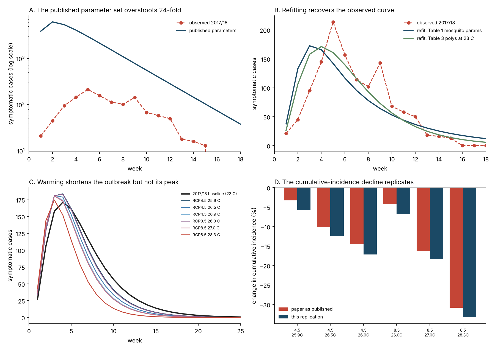

# Yellow fever in Brazil under climate change — a camdl replication

Replicates Sadeghieh, Sargeant, Greer, Berke, Dueymes, Gachon, Ogden & Ng (2021),
"Yellow fever virus outbreak in Brazil under current and future climate",
*Infectious Disease Modelling* 6:664–677,
[doi:10.1016/j.idm.2021.04.002](https://doi.org/10.1016/j.idm.2021.04.002),
using [camdl](https://github.com/vsbuffalo/camdl).

**Interactive write-up:** https://claude.ai/artifact/5gpwR7G5zp3RVQBJKXLgTC



## Headline

The paper's climate conclusion replicates. Its published parameter table does not
produce it.

| Claim | Verdict |
|---|---|
| Cumulative incidence falls with warming (−30.9% at RCP8.5 2071–2100) | **Replicates** (−33.3%) |
| Deaths fall with warming (294 at RCP8.5 2071–2100) | **Replicates** (296) |
| Outbreak duration shortens with warming | **Replicates**, somewhat more steeply |
| Peak incidence falls 9–20% | **Does not replicate** — flat to +7% under one parameterisation |
| Table 1 + Table 2 reproduce the paper's own fitted curve | **Does not replicate** — 30,175 cases vs 1,254 |

## What was done

The paper's nine-compartment vector–host system (Appendix A.1) is transcribed into
`yf_brazil.camdl`: humans `S → E → {I, A} → R` with `I → Dead`, mosquitoes
`X → Y → Z` as an open population. Weekly case data were digitised from the paper's
Figure 3 — no data file is published with it.

The digitisation is verified against three independent figures the paper reports in
Table 4: the 18 values sum to **1259**, peak at **214**, and span **15** non-zero
weeks. All three match exactly.

## Findings

### 1. The published parameters overshoot 24-fold

Run with every value exactly as Table 1 and Table 2 print them, the model gives
30,175 cases peaking in week 2. The paper's own fitted output is 1,254 cases peaking
in week 4. camdl's ODE backend and an independent hand-written RK4 integration agree
to three significant figures, so this is not a numerical artefact.

### 2. β₁ is not identifiable from human case data

Over this outbreak the susceptible pools barely move (S depletes by 0.007%), so the
system is effectively linear in the infected compartments. Multiplying β₁ by *c*
while dividing β₂, Y₀ and Z₀ by *c* leaves every human compartment **exactly**
unchanged — only β₁β₂, β₁Y₀ and β₁Z₀ are identified. Verified over three orders of
magnitude in `results/ridge_identifiability.tsv`; the optimiser confirms it
independently by sliding β₁ to whichever bound it is given at identical
log-likelihood. The paper reports β₁ and β₂ as separately estimated point values.

### 3. Table 1's death rate contradicts Table 4

ω = 2.38/week against γ = 0.82/week implies a case-fatality ratio of 74%. Table 4
reports 426 deaths from 1,254 cases, which is 34%. ω ≈ 0.422/week reproduces the
paper's own figure and is used throughout here.

### 4. Table 2's initial conditions cannot produce a week-4 peak

Seeding with 995 infectious mosquitoes puts the infectious pool at its maximum at
t = 0, so incidence can only fall. Rescaling β₁ until the case total matches still
peaks in week 2. A rising limb requires the seed in the **exposed** class with the
infectious count near zero, which is what the refit finds (Y₀ ≈ 60–95, Z₀ ≈ 0).

### 5. The baseline/scenario comparison is confounded

The paper's baseline uses the Table 1 mosquito parameters; its scenarios use the
Table 3 temperature polynomials. The two disagree at the same 23 °C baseline:

| | Table 1 | Table 3 polynomial at 23 °C |
|---|---|---|
| mosquito death rate μ | 0.36 | 0.305 |
| development rate δ | 0.58 | 0.370 |
| EIP rate λ₂ | 0.54 | 0.217 |

So the step from baseline to the first period mixes a temperature change with a
change of parameter source. Two baselines are therefore reported: **A** follows the
paper's procedure, **B** holds one parameterisation throughout.

### 6. The decline has a closed form

Because the outbreak is a decaying mosquito cohort rather than sustained
transmission, cumulative cases are proportional to the infectious-mosquito-weeks
that cohort delivers:

```
∫Z dt  ∝  λ₂ / [ μ (λ₂ + μ) ]
```

This predicts the simulated change in cumulative incidence **to the second decimal**
in all six scenarios (−5.73%, −12.43%, −17.17%, −6.79%, −18.37%, −33.27%). Warming
raises both rates; mortality wins because it enters twice. This is why the paper's
central result survives every problem above.

### 7. This is a spillover model, not a transmission model

R₀ is far below 1 in every parameterisation tried (0.03 to 0.52). Under baseline B
the optimiser drives human-to-mosquito transmission to its lower bound.

The paper's own Table 6 shows the same thing: its vaccination sweep is almost
perfectly linear in the susceptible fraction (successive 10-point steps change peak
incidence by 96, 97, 96, 96, 96, 96 cases). Real transmission feedback would curve.
Re-running the sweep with the paper's published β₂ reproduces that linearity and
lands within 8% of its cumulative incidence at every level.

This follows from the paper's own third simplifying assumption. Brazil's 2017/18
epidemic was sylvatic — *Haemagogus* cycling the virus through non-human primates,
spilling into people at forest edges. The paper excludes non-human primates, then
fits a human–mosquito transmission model to an epidemic that was not human–mosquito.
The fit resolves this by setting the feedback to nothing. The climate conclusion
survives, because it depends only on mosquito survival and incubation; claims about
transmission intensity or herd immunity do not.

### 8. Two arithmetic slips in Table 4

- **Deaths, RCP8.5 2071–2100.** 294 against a baseline of 426 is −31.0%. The table
  prints −40.0%. The cumulative-incidence cell on the same row is correct.
- **Peak baseline.** All six peak percentages are computed against a baseline peak
  of **184**, reproducing every printed value to the decimal. Table 4 prints that
  baseline as **185**; Table 6 gives the same quantity as 184.

Neither changes a conclusion.

## Reparameterisation

The paper writes mass action as `β₁·S·Z`, giving β₁ dimension 1/(count·week).
camdl's dimension lattice has no inverse-count literal, so the identical flow is
written per-capita against a **fixed** reference population:

```
β₁_paper · S · Z        ≡  beta1 · S · (Z / m_ref),  beta1 = β₁_paper · m_ref
β₂_paper · X · (I + A)  ≡  beta2 · X · ((I+A) / n_ref)
```

`m_ref`/`n_ref` are constants, not live totals, so the dynamics are unchanged.
Published values map to `beta1 = 218.685636`, `beta2 = 2.09469e-4` per week.

## Files

| File | What it is |
|---|---|
| `yf_brazil.camdl` | the model, transcribed from Appendix A.1 |
| `fit_yf_mle_pinned.toml` | baseline A — Table 1 mosquito parameters |
| `fit_yf_mle_t23.toml` | baseline B — Table 3 polynomials at 23 °C |
| `fit_yf_mle.toml` | β₁ left free, to show the ridge |
| `params/published.toml` | Table 1 + Table 2 exactly as printed |
| `yf_model.py` | camdl driver, Table 3 polynomials, outcome definitions, R₀ |
| `run_replication.py` | runs every scenario and writes `results/*.tsv` |
| `plot_replication.py` | the four-panel summary figure |
| `yf_replication.html` | the interactive write-up |
| `data/yf_brazil_201718_cases.tsv` | digitised weekly cases |

## Reproducing

Needs `camdl` (and `camdlc`) on `PATH`; see the camdl notes in the repository
`CLAUDE.md` for building both toolchains.

```bash
uv venv .venv && uv pip install -r requirements.txt
camdl check yf_brazil.camdl
camdl fit run fit_yf_mle_pinned.toml --seed 1
camdl fit run fit_yf_mle_t23.toml    --seed 1
camdl fit run fit_yf_mle.toml        --seed 1
.venv/bin/python run_replication.py
.venv/bin/python plot_replication.py
```

## Caveats

- **Duration** is defined here as the last week with expected incidence ≥ 1 case.
  The paper never states its definition; this choice gives 23 weeks for baseline B
  against its reported 21.
- The fit uses a **Poisson** likelihood on weekly counts; the paper used least
  squares. Point estimates are comparable, the uncertainty semantics are not.
- camdl's chain-agreement verdict reports a fail on all three fits. That reflects
  deliberately broad log-uniform priors sending many Latin-hypercube starts into
  hopeless regions, not an ambiguous optimum: the best ~10 of 64 starts agree to six
  decimal places. `results/fits/*/*/*/chain_results.tsv` has the per-chain detail.
- Only ω is calibrated outside the fit (to the paper's reported CFR); the case series
  carries no information about it, since observed incidence is the E→I flow.
